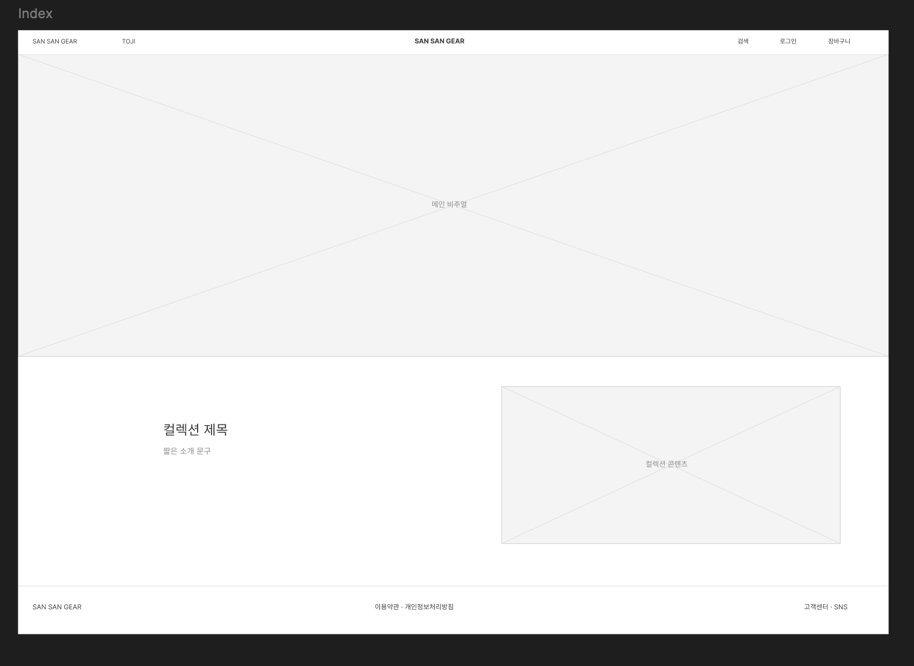
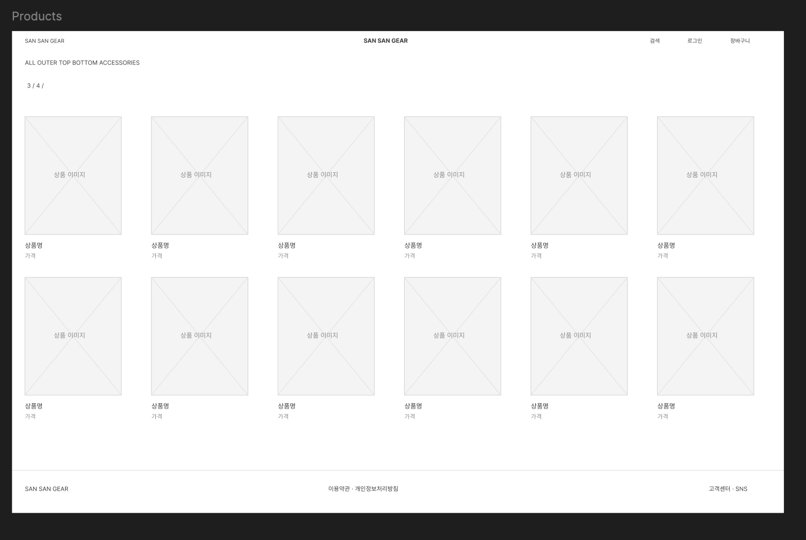
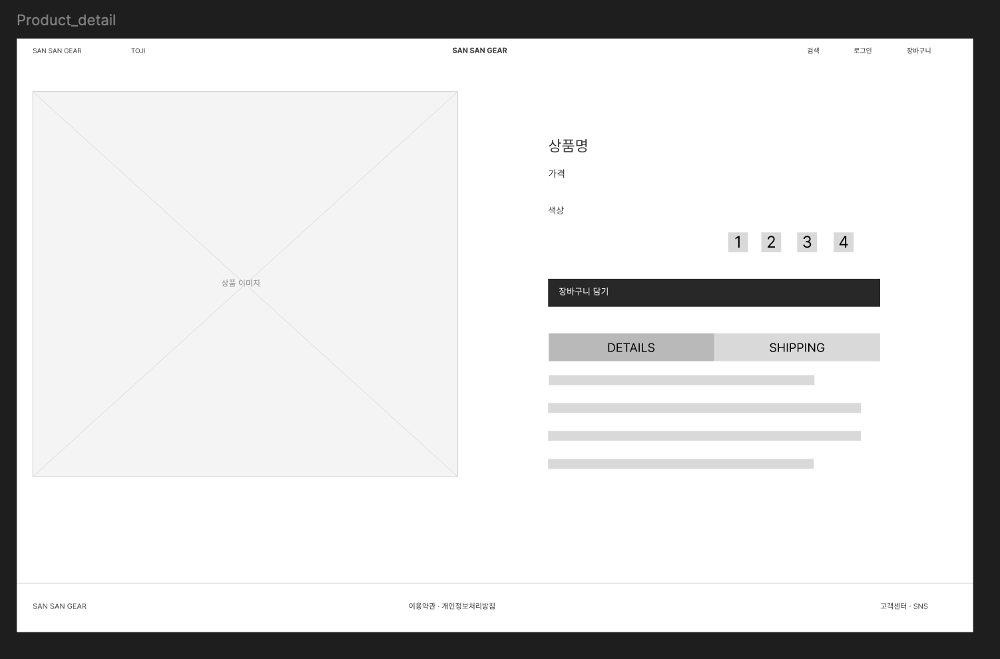
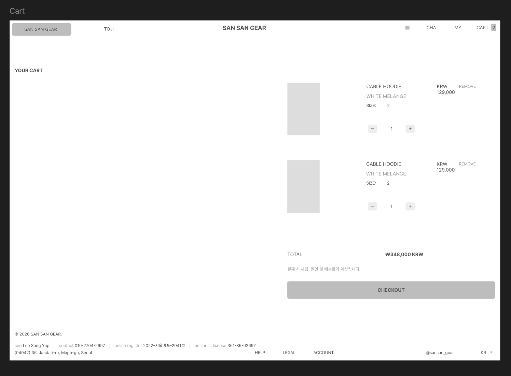

# 코드 컨벤션 제의

### 명명 방식

- 변수 : camelCase
- 함수 : camelCase
- 클래스 : PascalCase
- 인터페이스 : PascalCase
- 고정 상수 : UPPER_CASE

- 이름 : 의미있는 영어 이름 사용, 축약어 사용 금지 ( usr -> user / calc -> calculator )
- 참, 거짓 구분 변수 : isNew -> is조건으로 사용
- 함수 : 함수는 반드시 한가지의 행동만 수행
- 주석 : 모든 코드에 주석 작성, 코드가 무슨 일을 수행하는지, 어떤 이유로 작성했는지 등

### 협업 규칙

- 커밋
  - feat : 기능 추가
  - fix : 수정
  - docs : 문서 관련
- 브랜치
  - 기능/로그인 -> feat/login | fix/search_error 처럼 이름과 작업 목적 작성
  - PR : 한 가지 작업 단위로 올리고, 변경 내용과 확인 방법 작성 후 팀원에게 리뷰 후 병함

# 와이어 프레임 제작

### INDEX

### PRODUCTS

### PRODUCTS DETAIL

### CART

