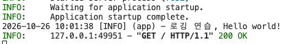

- IO 바운드 작업 -> 네트워크 작업, 외부 API 요청 전송
  - 비동기 특화 작업
  - 연산량이 적고, 대기시간이 긴 작업
- CPU 바운드 작업

--reload : 폴더에 변경점 생성할 때마다 자동으로 서버 재시작

## logging.basicConfig 설정 옵션

### level

- 출력할 최소 로그 레벨의 하한선(Threshold)을 지정
- 예를 들어 logging.INFO로 지정하면, 그보다 높은 등급인 INFO, WARNING, ERROR, CRITICAL 로그만 터미널에 나타나고, 가장 낮은 등급인 DEBUG 로그는 출력되지 않고 무시

### format

- 로그 메시지가 출력될 뼈대(레이아웃)를 결정
- 포맷 문자열 내부에서 특정 변수명(%(변수명)s)을 활용해 필요한 정보를 동적으로 주입

| 포맷 변수          | 형식   | 설명                                                                          |
| ------------------ | ------ | ----------------------------------------------------------------------------- |
| **%(asctime)s**    | 문자열 | 로그가 기록된 정확한 시각을 나타냅니다 (datefmt 설정을 따름).                 |
| **%(levelname)s**  | 문자열 | 로그의 중요도 및 위험 수준 레벨명을 대문자로 표시합니다 (예: INFO, ERROR).    |
| **%(name)s**       | 문자열 | 로그를 호출한 로거 인스턴스의 이름을 나타냅니다 (위 예시는 "app").            |
| **%(message)s**    | 문자열 | logger.info() 등에 개발자가 매개변수로 담아 보낸 실제 본문 로그 메시지입니다. |
| **%(filename)s**   | 문자열 | 로그가 실행된 소스코드의 파일명만 간결하게 표시합니다 (예: main.py).          |
| **%(funcName)s**   | 문자열 | 로그가 호출된 함수 또는 메서드의 이름을 표시합니다 (예: hello_world).         |
| **%(lineno)d**     | 정수   | 로그가 발생한 소스코드의 실제 몇 번째 라인(줄 번호)인지 표시합니다.           |
| **%(process)d**    | 정수   | 현재 해당 로그 연산을 구동 중인 OS 프로세스 ID(PID)를 표시합니다.             |
| **%(threadName)s** | 문자열 | 로그를 처리 중인 현재 스레드의 이름을 출력합니다.                             |

### datefmt

- 시간 표기 변수인 %(asctime)s의 구체적인 시간 출력 형식을 결정

| **포맷 기호** | **형식**   | **설명**                                                      |
| ------------- | ---------- | ------------------------------------------------------------- |
| **%Y**        | 4자리 연도 | 세기 정보가 포함된 연도를 대입합니다 (예: 2026).              |
| **%m**        | 2자리 월   | 월 정보를 01부터 12 사이의 고정 자릿수로 대입합니다 (예: 07). |
| **%d**        | 2자리 일   | 일 정보를 01부터 31 사이의 고정 자릿수로 대입합니다 (예: 05). |
| **%H**        | 2자리 시간 | 24시간 표기법 기반의 시간 정보입니다 (00 ~ 23) (예: 15).      |
| **%M**        | 2자리 분   | 분 정보를 00부터 59 사이의 숫자로 대입합니다 (예: 21).        |
| **%S**        | 2자리 초   | 초 정보를 00부터 59 사이의 숫자로 대입합니다 (예: 10).        |

### logger에서 사용할 수 있는 5가지 로깅 등급 메서드

- logger.info(...) 외에도 로그 메시지의 긴급도와 목적에 따라 다음과 같은 5가지 메서드를 활용 가능

| **메서드명**             | **수치값** | **주요 용도 및 개발 배치 가이드**                                                                |
| ------------------------ | ---------- | ------------------------------------------------------------------------------------------------ |
| **logger.debug(msg)**    | 10         | **개발 과정의 정밀 추적**: 변수 상태 대조, SQL 쿼리 로드 등 상세 디버깅용입니다.                 |
| **logger.info(msg)**     | 20         | **시스템의 정상 상태 기록**: HTTP 수신, 서버 시동 등 업무 흐름이 정상 작동 중임을 알립니다.      |
| **logger.warning(msg)**  | 30         | **주의 및 경고**: 당장 장애가 난 것은 아니나, 보안 실패나 임박한 만료 등 추후 조사가 필요합니다. |
| **logger.error(msg)**    | 40         | **기능 예외 실패**: 결제 타임아웃, 연산 실패 등이 발생했으나 서버 기동은 유지되는 결함입니다.    |
| **logger.critical(msg)** | 50         | **시스템 마비 예외**: DB 연결 고사 등 즉시 서버가 정지될 수 있는 치명적 재난 상황에 배치합니다.  |

### 실제 적용

```python
logging.basicConfig(
    level=logging.INFO, # level INFO로 변경
    format="%(asctime)s [%(levelname)s] (%(name)s) - %(message)s", # `시간 레벨 이름 - 메시지` 으로 로그 형태 변경
    datefmt="%Y-%m-%d %H:%M:%S" # `시간 포맷 지정`
)
```



<br>
<br>
<br>

# 1-2 HTTP Method & 기본 라우팅

### HTTP Method

| **HTTP 메서드** | **주된 역할 (CRUD)** | **안전함 (Safety)** | **멱등성 (Idempotency)** | **요청 본문 (Payload)** | **성공 시 표준 상태 코드** |
| --------------- | -------------------- | ------------------- | ------------------------ | ----------------------- | -------------------------- |
| GET             | 조회 (Read)          | Yes                 | Yes                      | 권장하지 않음           | 200 OK                     |
| POST            | 등록 (Create)        | No                  | No                       | 필수                    | 201 Created                |
| PUT             | 전체 교체 (Update)   | No                  | Yes                      | 필수                    | 200 OK 또는 204 No Content |
| DELETE          | 완전 삭제 (Delete)   | No                  | Yes                      | 권장하지 않음           | 204 No Content             |

### REST ( Representational State Transfer)

### 도메인 모델

- 전문가 영역
- 비즈니스 요구사항 -> 개발자가 해결해야 할 문제 영역
- 비즈니스 요구 사항( 데이터 + 행위 ) 을 담은 설계도
- 변수, 함수, 용어 -> 비즈니스 영역의 용어와 일치

## FastAPI 데이터 처리 삼총사

### Body(..)

- 요청의 본문(Payload)에서 데이터를 꺼내옴
- 로그인 비밀번호나 상품 등록 정보처럼 주소창에 노출되면 안되거나, 용량이 큰 데이터를 안전하게 전달 받을 때 ( POST, PUT 요청) 사용
- application/json : JSON 문자열

### Query(..)

- 쿼리스트링 값
- 목록을 조회(GET)할 때 특정 조건으로 필터링하거나 정렬 방식을 지정하기 위해 사용

### Field(..)

- 2강에서 더 배움
- 유효성 검사 역할

<br>
<br>

| **설정 항목**           | **Body** | **Query** | **Field** | **주요 역할 및 설명**                                                                             |
| ----------------------- | -------- | --------- | --------- | ------------------------------------------------------------------------------------------------- |
| default (또는 ...)      | ✓        | ✓         | ✓         | 기본값을 설정합니다. ...(Ellipsis)를 넣으면 필수 입력 항목이 됩니다.                              |
| description             | ✓        | ✓         | ✓         | Swagger UI 문서에 해당 항목이 어떤 데이터인지 설명글을 추가합니다.                                |
| title                   | ✓        | ✓         | ✓         | API 문서에서 필드 이름 대신 보여줄 직관적인 제목을 지정합니다.                                    |
| alias                   | ✓        | ✓         | ✓         | 클라이언트가 보내는 키 이름(예: user_id)을 서버 변수명(예: userId)과 다르게 매핑할 때 사용합니다. |
| min_length / max_length | ✗        | ✓         | ✓         | 텍스트(문자열)의 최소 및 최대 글자 수를 제한하는 검증 기능입니다.                                 |
| gt / ge / lt / le       | ✗        | ✓         | ✓         | 숫자의 크기를 제한합니다. (gt: 초과, ge: 이상, lt: 미만, le: 이하)                                |
| pattern (정규표현식)    | ✗        | ✓         | ✓         | 이메일, 전화번호 형식처럼 특정 문자열 패턴에 맞는지 엄격하게 검사합니다.                          |
| embed                   | ✓        | ✗         | ✗         | 본문 데이터가 단 한 개일 때도 JSON 객체 형태로 감싸서 받을지 여부를 결정합니다. (True / False)    |
