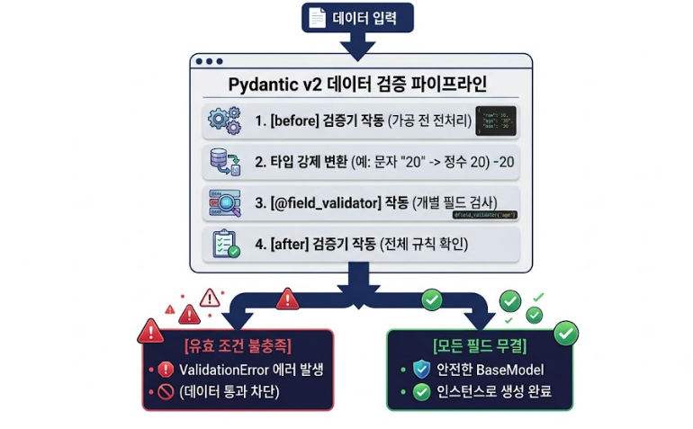

# DQ REVIEW

1. FastAPI가 채택한 ASGI 방식이 WSGI 대비 동시 요청 처리량을 높일 수 있는 핵심 원리로 가장 적절한 것
   - ASGI 비동기 서버 - 약간 지연 -> 요청 -> 백그라운드 위임 -> 이벤트 루프 -> 응답
   - WSGI 동기 서버
2. FastAPI에서 비동기 이벤트 루프가 처리하기 어려운 무겁고 오래 걸리는 동기 함수(def)로 선언된 엔드포인트를 백그라운드의 별도 작업자들에게 위임하는 구조
   - 쓰레드풀 : 여러 쓰레드를 기본 생성, 관리하는 영역
   - 요청 처리 함수 : `@app.get(..), @app.post(..)`
   - async def : 코루틴(비동기) / IO 바운드 작업
   - x def : 동기식 / 멀티 쓰레드 / CPU 바운드 작업 -> 동기식으로 정의된 함수가 호출?
3. logging.basicConfig에서 level=logging.INFO로 설정시에, 콘솔에 출력되지 않는 로그 레벨
   - DEBUG
     LEVEL : DEBUG < INFO < WARNING < ERROR < CRITICAL
4. RESTful API 설계에서 HTTP 메서드의 성질에 대한 설명
   - 요청 메서드, 주소 (URI/URL)
5. FastAPI에서 클라이언트가 보내는 외부 키 이름과 파이썬 내부 변수명이 다를 때 (예약어 충돌), 외부 통신 시 사용할 이름을 지정해주는 Body/Query/Field 공통 옵션의 이름

<br>
<br>
<br>
<br>
<br>

# 2-1 타입 힌트 & Pydantic 모델 검증

## 복합 타입을 위한 typing 라이브러리

- 파이썬이 기본으로 제공하는 자료형 타입 만으로는 '문자열 여러개 담긴 리스트' or '값이 비어 있을수도 있는 변수' 처럼 복잡한 데이터 구조를 표현하기 어려움, 이때 typing 라이브러리를 가져와 확장된 타입 힌트 사용

### List

- 여러 개의 동일한 데이터 타입을 한 바구니에 순서대로 담을 떄 사용

```python
from typing import List
# 문자열만 담을 수 있는 리스트 양식 선언
book_tags: List[str] = ["컴퓨터", "웹백엔드", "초보자"]
```

### Optional

- 필수 입력값이 아니여서 값이 있을수도, 없을수도(None) 있는 칸에 사용

```python
from typing import Optional
# 할인가가 없을 수도 있으므로 int 혹은 None만 허용하는 양식 선언
discount_price: Optional[int] = None
```

### Dict

- key - value 쌍으로 이루어진 데이터 매핑시에 사용

```python
from typing import Dict
# 글자로 된 이름(str)과 정수형 나이(int)를 짝지어 담는 사전 양식 선언
user_ages: Dict[str, int] = {"홍길동": 20, "임꺽정": 22}
```

### Tuple

- 데이터의 순서와 크기가 고정되어 있고, 내부에 담긴 데이터를 수정이 불가능한 고정 배열에 사용

```python
from typing import Tuple
# 위도(float)와 경도(float)가 한 쌍으로 묶여 수정 불가능한 좌표 양식 선언
store_location: Tuple[float, float] = (37.5665, 126.9780)
```

### Union

- 하나의 칸에 한 가지가 아니라 지정된 여러 타입 중 아무거나 들어와도 괜찮을 때 복수 허용 목적으로 사용

```python
from typing import Union
# 고유 식별자로 숫자(int)와 문자(str) 형식을 모두 허용하는 양식 선언
book_identifier: Union[int, str] = 1002
```

### Literal

- 변수 타입이 아닌, 지정된 몇 가지 정확한 `값 (글자 or 숫자) 자체`만 골라서 들어올 수 있도록 제한 할 때 사용

```python
from typing import Literal
# "TODO", "DOING", "DONE" 이 세 가지 글자 중에서만 데이터 입력을 허용하는 양식 선언
task_status: Literal["TODO", "DOING", "DONE"] = "TODO"
```

## 데이터 검증의 전체 흐름



## Pydantic

### BaseModel [기본 모델 클래스] / @model_validator

- Pydantic이 제공하는 데이터 양식의 부모 클래스
- 만들 데이터 클래스 뒤에 BaseModel을 적어 상속 받으면, 파이썬은 단순한 객체가 아닌 데이터 타입을 스스로 검증 할 수 있는 데이터 양식(Schema)가 됨

### Field [필드 제약 함수] / @field_validator

- BaseModel 내부에 선언할 각 데이터 칸에 구체적인 규칙(필수 여부, 글자 수 제한, 숫자 범위, 설명 등)을 세부적으로 심어주는 함수
  | **매개변수** | **의미** | **용도 및 예시** |
  | --- | --- | --- |
  | ... (말줄임표) | 필수 입력값 | 기본값을 채워두지 않고, 사용자가 반드시 값을 보내야 하는 칸에 사용합니다. |
  | default | 기본값 | 사용자가 값을 보내지 않았을 때 자동으로 채워질 기본값을 지정합니다. (예: default=None) |
  | default_factory | 기본값 생성 함수 | 리스트나 딕셔너리처럼 객체가 매번 새로 독립적으로 만들어져야 할 때 사용합니다. (예: default_factory=list) |
  | min_length / max_length | 최소 / 최대 길이 | 문자열(str) 데이터의 최소 및 최대 글자 수를 제한합니다. (예: min_length=2) |
  | gt / ge | 초과 / 이상 | 숫자의 크기 제한 조건을 설정합니다. gt는 초과(Greater Than), ge는 이상(Greater or Equal)을 뜻합니다. (예: gt=0) |
  | lt / le | 미만 / 이하 | 숫자의 크기 제한 조건을 설정합니다. lt는 미만(Less Than), le는 이하(Less or Equal)를 뜻합니다. (예: le=5) |
  | description | 데이터 설명 | 이 칸이 어떤 데이터인지 기록해 두는 설명 메모입니다. 웹 API 명세서 문서에 자동으로 연동되어 나타납니다. |
