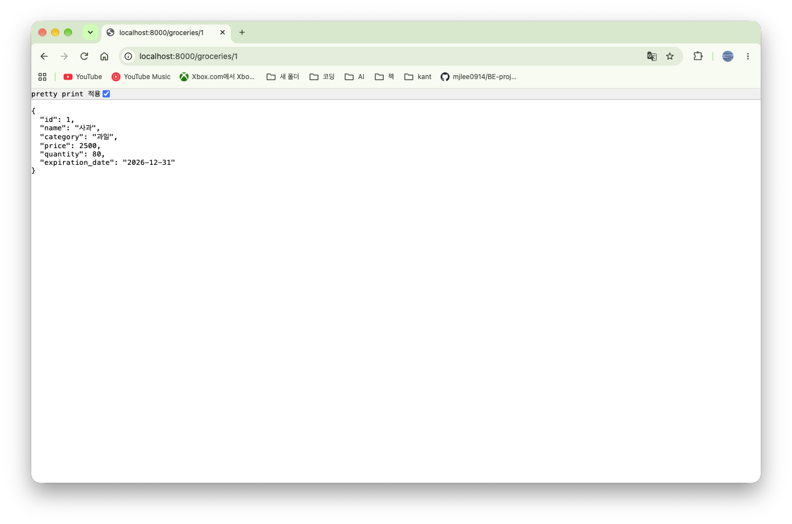
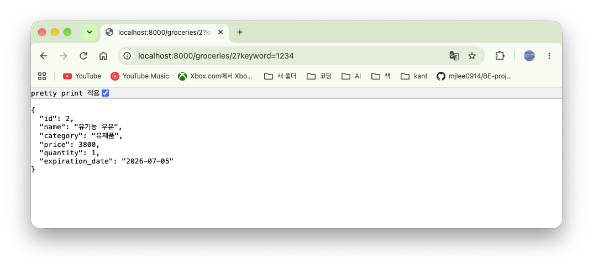
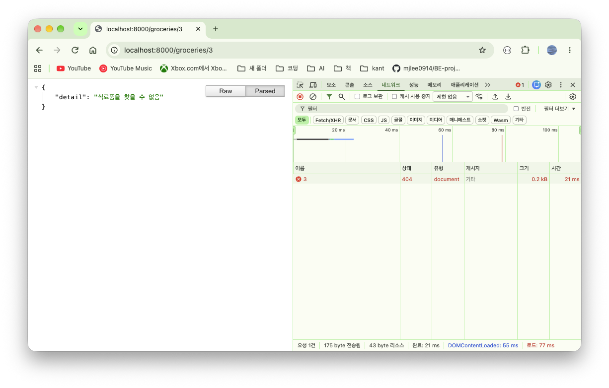
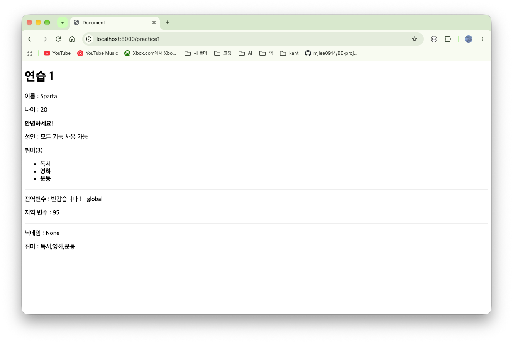

# 3-1

### 경로 변수 (Path) & 쿼리 변수 (Query)

| **구분**      | **경로 변수 (Path Parameter)**                    | **쿼리 변수 (Query Parameter)**                         |
| ------------- | ------------------------------------------------- | ------------------------------------------------------- |
| **위치**      | 주소(URL) 경로의 일부로 포함됨 (/items/{item_id}) | 주소 끝 물음표(?) 오른쪽에 붙음 (/items?limit=10)       |
| **목적**      | 특정 데이터 하나를 지정할 때 (예: 회원 번호)      | 데이터 목록을 검색, 정렬, 필터링할 때 (예: 10개만 보기) |
| **전담 도구** | fastapi.Path                                      | fastapi.Query                                           |
| **생략 여부** | 필수 입력 (생략 시 주소를 찾을 수 없음)           | 선택 입력 (안 적으면 기본값이나 None 적용 가능)         |

#### 실습 코드

```python
import logging
from typing import Dict
from datetime import date
from fastapi import FastAPI, Path, Query

logging.basicConfig(level=logging.INFO)
logger = logging.getLogger("app")

app = FastAPI()


grocery_database: Dict[int, dict] = {
    1: {
        "id": 1,
        "name": "사과",
        "category": "과일",
        "price": 2500,
        "quantity": 80,
        "expiration_date": date(2026, 12, 31)
    },
    2: {
        "id": 2,
        "name": "유기농 우유",
        "category": "유제품",
        "price": 3800,
        "quantity": 1,
        "expiration_date": date(2026, 7, 5)
    }
}

@app.get("/groceries/{item_id}")
async def get_grocery(
    item_id: int = Path(..., description="상품 ID")
):
    return grocery_database[item_id]
```



### Annotated를 사용한 코드 작성법

- Python에는 `기본값이 있는 변수 뒤에 기본값이 없는 변수가 올 수 없다`는 규칙이 있음
- 이때문에 과거의 FastAPI 코드에서는 변수를 적는 순서가 강제되는 불편함 존재
- Annotated 형식을 사용하여 변수의 타입 선언 내부에 검증 규칙을 포함
- Annotated[타입, 도구] 형태로 작성

#### Annotated 내부 구조

- 첫 번째 인자 : 변수의 순수한 파이썬 타입을 지정
- 두 번째 인자 : FastAPI의 제약 조건 도구 (Path(), Query())와 세부 옵션 지정

### 에러 알림 (HTTPException) & 추가 정보 전달

- 사용자가 요청한 상품이 DB에 존재하지 않으면 즉시 작업을 중단하고 사용자에게 상황을 알려야 함
- 이때 HTTPException을 사용하면 그 자리에서 실행을 멈추로 에러 상태 전달

#### HTTPException 내부 옵션

- status_code : 브라우저와 통신할 때 사용하는 상태 코드
- detail : 사용자나 개발자가 읽을 수 있는 구체적인 에러 메시지
- headers : 응답 패킷의 머리글 영역에 기계가 읽을 수 있는 커스텀 에러 키와 키 값을 추가하여 전달

<br>
<br>
<br>

```python
import logging
from typing import Dict, Optional, Annotated
from datetime import date
from fastapi import FastAPI, Path, Query, HTTPException, status


logging.basicConfig(level=logging.INFO)
logger = logging.getLogger("app")

app = FastAPI()


grocery_database: Dict[int, dict] = {
    1: {
        "id": 1,
        "name": "사과",
        "category": "과일",
        "price": 2500,
        "quantity": 80,
        "expiration_date": date(2026, 12, 31)
    },
    2: {
        "id": 2,
        "name": "유기농 우유",
        "category": "유제품",
        "price": 3800,
        "quantity": 1,
        "expiration_date": date(2026, 7, 5)
    }
}

# @app.get("/groceries/{item_id}")
# async def get_grocery(
#     item_id: int = Path(..., description="상품 ID")
# ):
#     return grocery_database[item_id]

@app.get("/groceries/{item_id}")
async def get_grocery(
    item_id : Annotated[int, Path(..., description="상품 ID")],
    keyword: Annotated[Optional[str], Query(description="키워드")] = None
):
    if item_id not in grocery_database:
        raise HTTPException(
            status_code=status.HTTP_404_NOT_FOUND,
            detail="식료품을 찾을 수 없음"
        )


    logger.info(f"keyword={keyword}")
    return grocery_database[item_id]
```


<br>
<br>

<br>
<br>
<br>
<br>

# 3-2

### SSR의 흐름 & 구조적 장점

- CSR : 브라우저가 화면을 그리는 방식
- SSR : 서버가 화면을 완성해서 보내는 방식
- SSR은 사용자가 첫 화면을 보는 속도가 빠르며, 검색 엔진 봇이 웹사이트의 텍스트 정보를 쉽게 읽고 분석이 가능하여 검색 엔진 최적화 측면에서 유리

| **비교 지표**              | **클라이언트 사이드 렌더링 (CSR)**       | **서버 사이드 렌더링 (SSR)**         |
| -------------------------- | ---------------------------------------- | ------------------------------------ |
| **화면을 만드는 주체**     | 사용자 웹 브라우저                       | 백엔드 웹 서버                       |
| **최초 요청 시 받는 파일** | 빈 뼈대용 HTML 및 JS 파일                | 데이터 결합이 끝난 완성형 HTML 파일  |
| **초기 화면 표시 속도**    | 브라우저가 화면을 조립하느라 조금 느림   | 서버가 완성해서 주므로 빠른 편임     |
| **검색 엔진 최적화 (SEO)** | 동적 데이터 수집에 어려움이 있을 수 있음 | 정제된 텍스트가 즉시 읽히므로 유리함 |

### JINJA2

- 파이썬 웹 개발에서 자주 쓰이는 화면 제작 도구(템플릿 엔진)

#### main.py

```python
import os
import logging
from fastapi.responses import HTMLResponse
from fastapi import FastAPI, Request
from fastapi.templating import Jinja2Templates

logging.basicConfig(level=logging.INFO)
logger = logging.getLogger("app")

app = FastAPI()

# templates 절대 경로를 템플릿 엔진에 설정
CURRENT_DIR = os.path.dirname(__file__)
templates = Jinja2Templates(directory=os.path.join(CURRENT_DIR, "templates"))
templates.env.add_extension("jinja2.ext.do")

@app.get("/practice1", response_class=HTMLResponse)
async def jinja_practice1(request: Request):
    student_context = {
        "name" : "Sparta",
        "age": 20,
        "hobbies" : ["독서", "영화"],
        "nickname": None,
        "html_code" : "<strong> 안녕하세요! </strong>"
    }
    return templates.TemplateResponse(
        request=request,
        name="practice1.html",
        context=student_context
    )
```

### practice1.html

```
<!doctype html>
  <head>
    <meta charset="UTF-8" />
    <title>Document</title>
  </head>
  <body>
    <h1>연습 1</h1>
    <p>이름 : {{ name }} </p>
    <p>나이 : {{ age }} </p>
    <p>{{html_code | safe }}</p> <!-- safe = html코드로 인식할 수 있도록 함 -->

    
        <p>성인 : 모든 기능 사용 가능</p>
    
        <p>청소년 : 일부 기능 제한</p>
    
        <p>어린이: 이용 불가</p>
    

    
    <p>취미({{ hobbies | length }})</p>
    <ul>
        
            <li>{{hobby}}</li>
        
    </ul>
    <hr>
    
    <p>전역변수 : {{global_msg}} </p>

    
    <p>지역 변수 : {{local_score }}</p>
    

    <hr>
    <p>닉네임 : {{ nickname | default('익명') }} </p>
    <p>취미 : {{hobbies | join(',')}}</p>
  </body>
</html>
```


