# 3-2 (이어서)

### 매크로 (Macro)

- HTML 안에서 **함수처럼** 재사용하는 UI 조각
- 별도 파일(common_macro.html)에 정의하고 ``로 불러와 사용

```html
<!-- common_macro.html -->

<button type="{{ type | default('button', true) }}">{{ text }}</button>

```

```html
<!-- practice1.html -->
 {{ render_button ("취소하기"
, "reset") }} {{ render_button ("등록하기" , "submit") }}
```

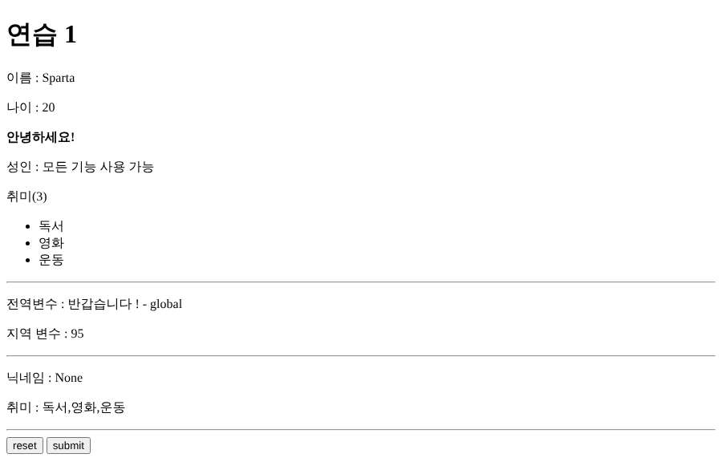

> ⚠️ 매크로는 정의한 **인자 순서대로** 값이 들어감
> `render_button(type, text)`인데 `("취소하기", "reset")` 순서로 넘겨서 버튼 글자가 reset / submit으로 출력됨
> → `render_button("reset", "취소하기")` 순서로 넘기거나 `render_button(type="reset", text="취소하기")`처럼 이름을 붙여서 넘기면 해결

> ⚠️ `default('익명')`은 값이 **정의되지 않았을 때만** 동작함 → `None`은 그대로 "None"으로 출력됨
> None이나 빈 값도 기본값으로 바꾸려면 `default('익명', true)`처럼 두 번째 인자에 true를 넣어야 함

### 템플릿 포함 (include) & 상속 (extends)

| **구분** | **include**                  | **extends + block**                   |
| -------- | ---------------------------- | ------------------------------------- |
| **역할** | 화면 조각을 그대로 끼워 넣음 | 전체 틀을 물려받고 빈칸(block)만 채움 |
| **비유** | 부품                         | 설계도                                |
| **예시** | 헤더, 푸터                   | 공통 레이아웃(base.html)              |

#### layouts/base.html

```html
<body>
  
  <main> </main>
  
</body>
```

#### practice2.html

```html
 
<h2>치환된 영역...</h2>
  사이트 제목 
```

- 자식 템플릿은 **block 안의 내용만** 작성하면 나머지(헤더/푸터)는 부모에서 그대로 가져옴
- block 순서는 상관없음 (title을 뒤에 적어도 제자리에 들어감)


### Form 데이터 받기

- HTML `<form>`으로 보낸 데이터는 JSON이 아니라 **폼 데이터** 형식
- FastAPI에서는 `Form()`으로 받아야 하고, 이를 위해 `python-multipart` 설치가 필요함

```python
@app.post("/practice3/process")
async def jinja_practice3_process(
    title: str = Form(description="제목"),
    content: str = Form(description="내용")
):
    logger.info(f"title={title}, content={content}")
```

- `<input name="title">`의 **name 값**과 파이썬 매개변수 이름이 같아야 매칭됨

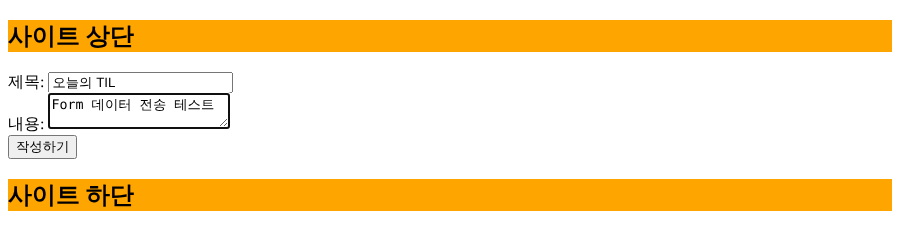
<br>
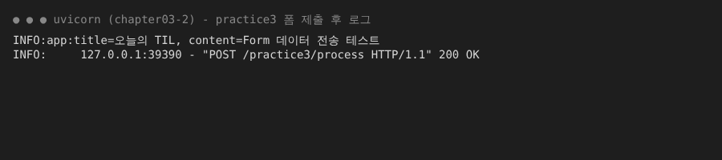

### 파일 업로드

- 파일을 보낼 때는 form에 `enctype="multipart/form-data"`를 꼭 붙여야 함
- 서버에서는 `UploadFile = File()`로 받음

```html
<form method="post" action="/file" enctype="multipart/form-data">
  파일 선택: <input type="file" name="file" />
  <button type="submit">업로드</button>
</form>
```

```python
@app.post("/file")
async def file_upload_process(file: UploadFile = File()):
    logger.info(f"file={file}")
```


<br>
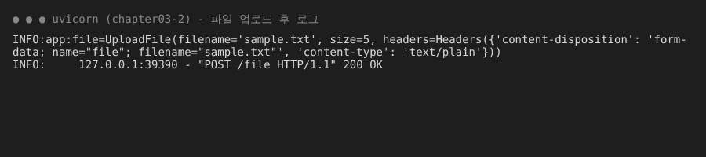

- UploadFile 객체에 파일명(filename), 크기(size), 타입(content-type) 정보가 담겨 있음

### 정적 파일 (Static Files)

- CSS, 이미지처럼 **바뀌지 않는 파일**을 웹 주소에 연결하는 설정

```python
# app.mount("웹 주소", StaticFiles(directory="실제 폴더"), name="식별 이름")
app.mount("/static2", StaticFiles(directory=os.path.join(CURRENT_DIR, "static")), name="static")
app.mount("/img", StaticFiles(directory=os.path.join(CURRENT_DIR, "static/img")), name="img")
```

- HTML에서는 경로를 직접 적지 않고 `url_for('식별 이름', path='/파일')`로 호출
  → 웹 주소(`/static2`)가 바뀌어도 name만 같으면 링크가 깨지지 않음

```html
<link rel="stylesheet" href="{{ url_for('static', path='/css/style.css') }}" />
```

<br>
<br>
<br>
<br>

# 4-1

### DRY

- Do not Repeat Yourself
- 같은 코드를 반복하지 말고, 한 곳에 모아서 재사용하자는 원칙
- 오늘 배운 매크로, include/extends, APIRouter, Depends 모두 DRY를 위한 도구

### APIRouter

- 기능별(주문, 게시판...)로 API를 **파일을 나눠서** 관리하는 도구
- main.py는 라우터들을 `include_router()`로 합치는 역할만 수행

| **설정**         | **의미**                                              |
| ---------------- | ----------------------------------------------------- |
| **prefix**       | 라우터 안 모든 주소 앞에 붙는 공통 주소               |
| **tags**         | Swagger 문서에서 API를 묶어주는 그룹 이름             |
| **dependencies** | 라우터 전체 API에 공통으로 먼저 실행할 규칙 (Depends) |

#### order/presentation/router.py

```python
# 요청 헤더명 X-TOKEN
def verify_secret_token(x_token: str | None = Header(None)):
  if x_token != "secret":
    raise HTTPException(status_code=403, detail="토큰이 잘못되었습니다.")

router = APIRouter(prefix="/v1/order", tags=["주문", "태그1"], dependencies=[Depends(verify_secret_token)])

# GET /v1/order
@router.get("", description="주문 목록")
async def get_orders():
  pass
```

#### main.py

```python
from order.presentation.router import router as order_router
from board.presentation.router import router as board_router

app.include_router(order_router)
app.include_router(board_router)
```

- tags를 여러 개 주면 Swagger에서 **각 태그 그룹에 모두** 표시됨 (주문, 태그1)

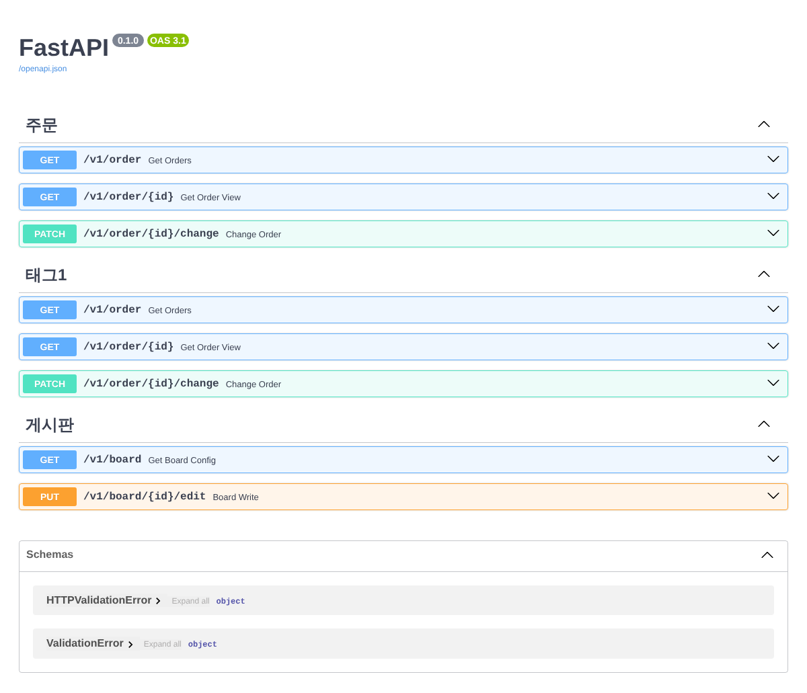

### Depends (의존성)

- 라우터에 `dependencies=[Depends(함수)]`를 걸면 **모든 API 실행 전에** 그 함수가 먼저 실행됨
- 토큰 검사처럼 반복되는 코드를 API마다 적지 않아도 됨 (DRY)
- `x_token` 변수 → 실제 헤더 이름은 `X-Token` (언더바가 하이픈으로 자동 변환)

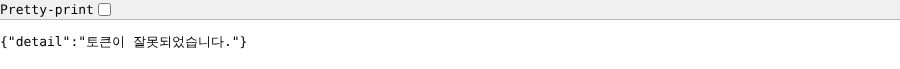

### 미들웨어 (Middleware)

- 요청이 API에 도착하기 **전**, 응답이 나가기 **직전**에 끼어드는 필터
- `call_next(request)`를 기준으로 위는 전처리, 아래는 후처리

```python
@app.middleware('http')
async def middleware1(request: Request, call_next):
  logger.info("middleware()의 요청처리 전")
  response = await call_next(request)   # 실제 API 실행
  logger.info("middleware()의 응답처리 전")
  return response

@app.middleware('http')
async def middleware2(request: Request, call_next):
  ...

app.add_middleware(TrustedHostMiddleware, allowed_hosts=["127.0.0.1"])
```

#### 실행 순서 = 양파 구조

- **나중에 등록한 미들웨어가 가장 바깥 껍질** → 요청을 가장 먼저 받음
- 요청 → middle2 → middle1 → API 처리 → middle1 → middle2 → 응답

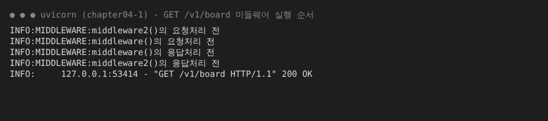

#### TrustedHostMiddleware

- 허용한 호스트로 들어온 요청만 통과시키는 내장 보안 미들웨어
- `allowed_hosts=["127.0.0.1"]`이라 `localhost`로 접속하면 **400 Invalid host header**

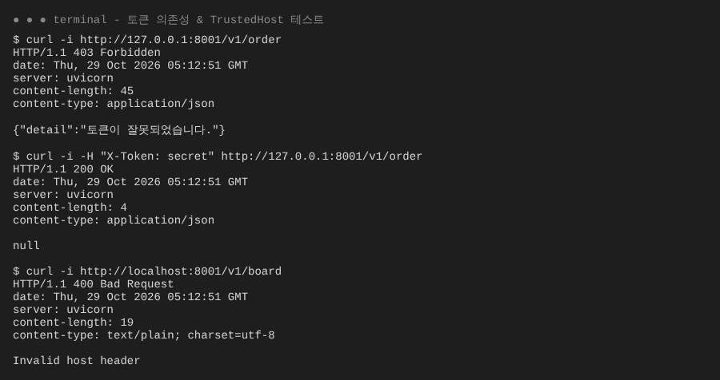

### 미들웨어 vs Depends

| **구분**      | **미들웨어**                      | **Depends (라우터 의존성)** |
| ------------- | --------------------------------- | --------------------------- |
| **적용 범위** | 서버로 들어오는 모든 요청         | 해당 라우터 그룹만          |
| **용도**      | 로깅, 처리 시간 측정, 호스트 보안 | 토큰 검사, 권한 확인        |
| **예외 처리** | 응답 객체를 직접 반환             | HTTPException 사용 가능     |

### CORS

- Cross Origin Resource Sharing
- 교차 출처 자원 공유 정책 ( 서버 - 브라우저 )
- 기본 정책 : 공유 차단
- 같은 출처 : 동일 서버, 프로토콜(http/https), 도메인주소, 포트번호가 모두 같아야 함
- 다른 출처로 요청할 때 브라우저가 먼저 `OPTIONS` 요청(**Preflight**)을 보내서 허용 여부를 물어봄

```
브라우저 -- OPTIONS (Preflight) --> 서버
        <-- 응답 헤더 (허용 메서드, CORS 허용 여부) --
X -> 오류
O -> GET/POST/... 본 요청 진행
```

- FastAPI에서는 `CORSMiddleware`로 허용할 출처를 설정함

### 로깅 모듈화

- 로그 서식은 main.py에서 `logging.basicConfig()`로 **한 번만** 설정
- 다른 파일에서는 `logging.getLogger("이름")`으로 로거만 가져와 사용
- 로그에 이름이 찍혀서 어느 파일에서 남긴 로그인지 바로 알 수 있음 (`INFO:MIDDLEWARE:...`)

<br>

### 💭 정리

- 오늘의 핵심은 **"나누고, 재사용하고, 공통 처리는 한 곳에서" (DRY)**
  - 화면 → 매크로, include, extends로 조각을 나누고 재사용
  - API → APIRouter로 기능별 파일 분리
  - 공통 로직 → 모든 요청은 미들웨어, 특정 그룹은 Depends
- 미들웨어 순서가 코드 순서와 **반대**라는 점은 꼭 기억하기

# DQ

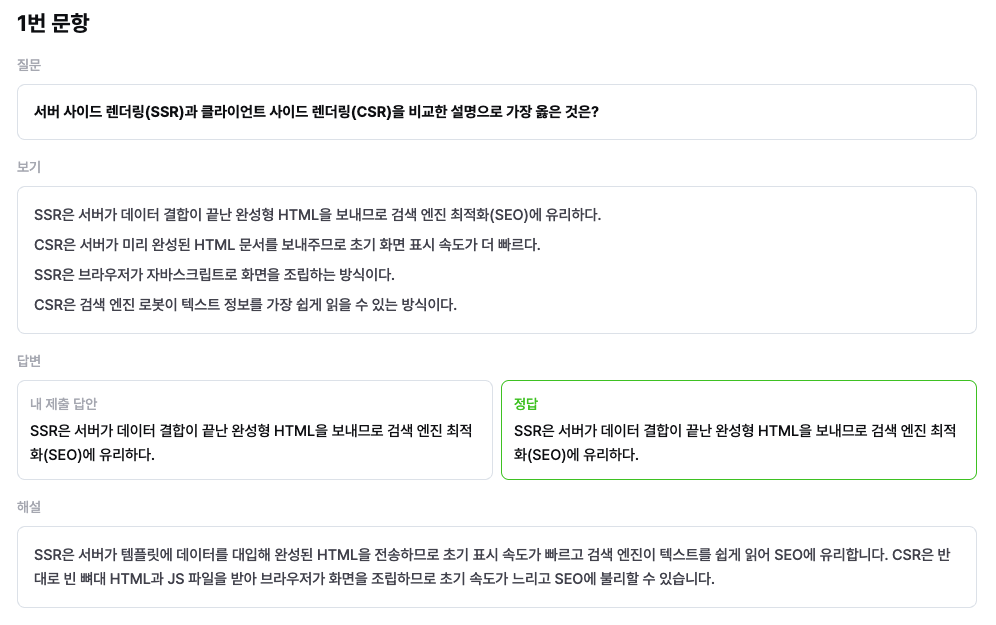
<br>
<br>

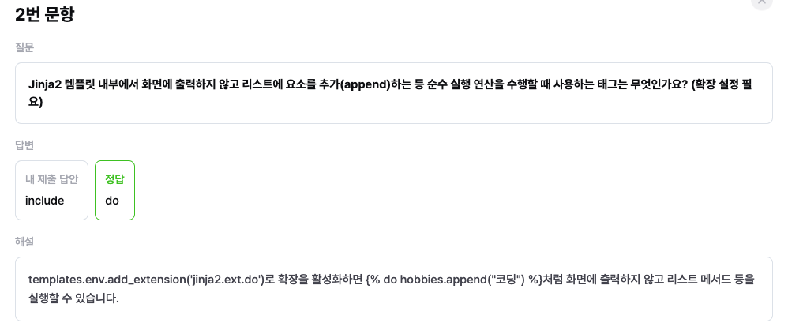
<br>
<br>

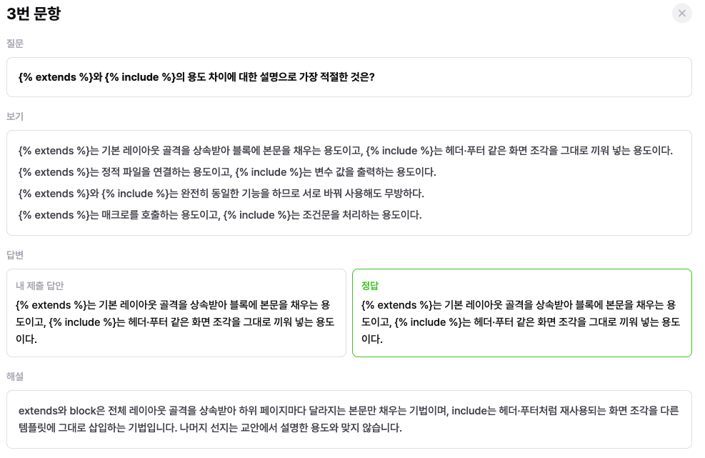
<br>
<br>

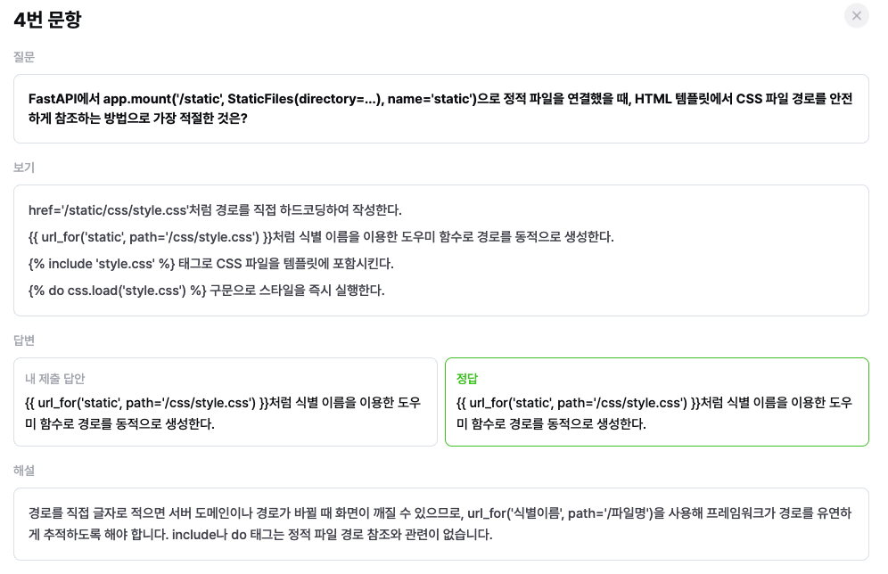
<br>
<br>

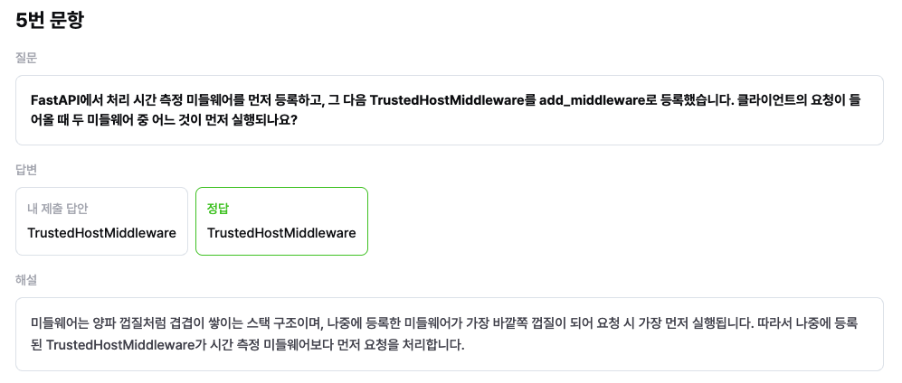
<br>
<br>
