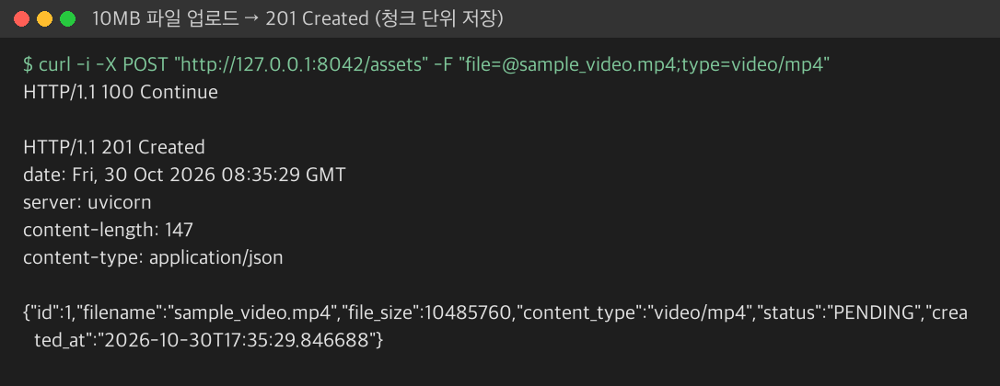
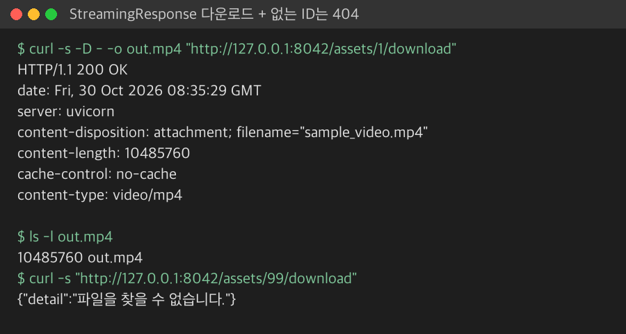
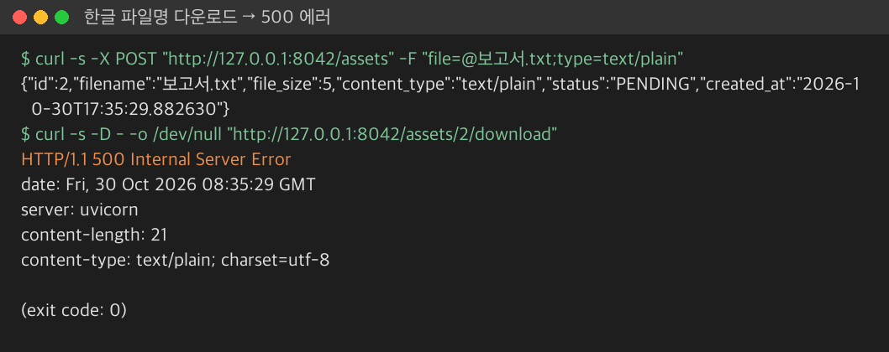
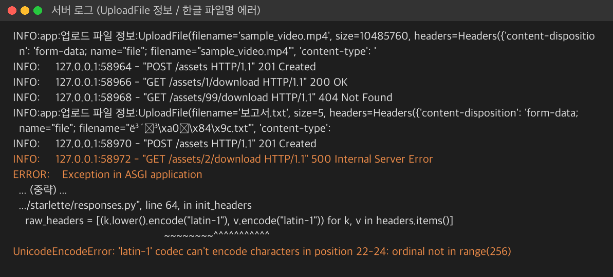
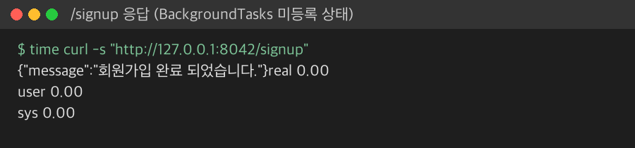

# 4-2

### 파일 업로드: bytes vs UploadFile

- 브라우저에서 파일을 보낼 때는 `multipart/form-data` 형식을 사용함 (파일과 텍스트를 구분자로 나눠 한 번에 보내는 형식)
- `bytes`는 파일 전체를 RAM에 한 번에 올림 → 큰 파일이 몰리면 서버가 멈출 수 있음
- `UploadFile`은 작은 파일은 메모리에 두고, 일정 크기(약 1MB)를 넘으면 임시 파일(디스크)에 씀 → 메모리 사용량이 일정함

| **구분**      | **file: bytes = File()** | **file: UploadFile**          |
| ------------- | ------------------------ | ----------------------------- |
| **메모리**    | 파일 전체를 RAM에 올림   | 크면 임시 디스크로 넘김       |
| **RAM 사용**  | 파일 크기에 비례         | 항상 일정                     |
| **메타데이터** | 원본 데이터만            | 파일명, content_type 등 제공  |
| **입출력**    | 동기                     | 비동기 `await file.read()` 지원 |
| **비유**      | 조립된 옷장을 통째로 밀어넣기 | 부품 상자로 나눠서 받기 (이케아) |

#### main.py (업로드)

```python
@app.post("/assets", response_model=AssetResponseSchema, status_code=status.HTTP_201_CREATED)
async def upload_asset(file: UploadFile = File(description="업로드 파일")):
    raw_filename = os.path.basename(file.filename) # 업로드한 파일명만 추출
    physical_target_path = MEDIA_STORAGE_DIR / f"seq_{asset_id_sequence}_{raw_filename}"

    async with aiofiles.open(physical_target_path, "wb") as local_disk_file:
        while True:
            binary_chunk = await file.read(1024 * 1024)  # 1MB씩 읽기
            if not binary_chunk: # 다 읽어온 경우
                break
            await local_disk_file.write(binary_chunk)
```

- `while True` + `file.read(1MB)` → 1MB씩 끊어서 디스크에 씀, 빈 값(`b""`)이 나오면 끝
- `aiofiles` → 파일 쓰기도 비동기로 처리해서 이벤트 루프를 막지 않음
- `os.path.basename()` → `../../etc/passwd` 같은 경로 조작 방지용으로 파일명만 남김
- 실패하면 `except`에서 쓰다 만 파일을 지우고 500 반환



<br>

### 도메인 모델 (MultimediaAsset)

- 파일 정보를 담는 객체가 **스스로 값을 검사**함 (파일명 공백, 크기 0 이하면 `ValueError`)
- 상태는 `PENDING → PROCESSING → COMPLETED` 순서로만 바뀌도록 `mark_as_processing()`, `mark_as_completed()`에서 막음
- 응답은 `to_dict()`로 변환 후 `AssetResponseSchema`(Pydantic)로 형식 검증

<br>

### StreamingResponse (파일 스트리밍)

- 큰 파일을 한 번에 메모리에 올리지 않고 **청크(Chunk, 데이터 조각) 단위로** 보내는 응답
- `yield`로 한 조각씩 내보내는 비동기 제너레이터와 같이 사용
- 보낸 조각은 바로 메모리에서 빠짐 → 파일 크기와 상관없이 메모리 사용이 가벼움
- 첫 조각부터 바로 전송 → TTFB(첫 바이트를 받기까지 걸리는 시간)가 짧아짐

#### main.py (다운로드)

```python
async def get_file_chunk(file_path: Path, chunk_size: int = 1024 * 1024) -> AsyncGenerator[bytes, None]:
    async with aiofiles.open(file_path, "rb") as out_file :
        while True:
            chunk = await out_file.read(chunk_size)
            if not chunk:
                break
            yield chunk

@app.get("/assets/{asset_id}/download")
async def file_download(asset_id: int):
    ...
    headers = {
        "Content-Disposition" : f'attachment; filename="{asset.filename}"',
        "Content-Length" : str(asset.file_size),
        "Cache-Control" : "no-cache"
    }
    return StreamingResponse(get_file_chunk(physical_target_path), media_type=asset.content_type, headers=headers)
```

- `Content-Disposition: attachment` → 브라우저가 화면에 띄우지 않고 파일로 저장함
- `Content-Length` → 전체 크기를 알려줘서 다운로드 진행률 표시 가능



> ⚠️ 한글 파일명(`보고서.txt`)은 업로드는 되는데 **다운로드에서 500 에러**가 남
> 원인: HTTP 헤더 값은 `latin-1`로만 인코딩되는데 헤더에 한글이 그대로 들어감
> → 교안의 `quote()`와 `filename*=UTF-8''...` 부분을 다시 비교해 보기





<br>

### BackgroundTasks (백그라운드 작업)

- 메일 발송, 영상 변환처럼 **오래 걸리는 작업**을 응답 뒤로 미룸
- 엔드포인트 인자로 `background_tasks: BackgroundTasks`를 받고 `add_task(함수, 인자)`로 예약
- 응답을 먼저 보내고 → 그 뒤에 예약한 작업이 실행됨 → 사용자는 기다리지 않음

```python
async def send_email(email: str):
    await asyncio.sleep(3)
    logger.info("회원 가입 안내 메일 전송 완료")

@app.get("/signup")
async def signup_done(background_tasks: BackgroundTasks):
    return {"message" : "회원가입 완료 되었습니다."}
```



> ⚠️ 응답은 바로 오지만 서버 로그에 "메일 전송 완료"가 **찍히지 않음**
> `background_tasks`를 받기만 하고 작업을 예약하는 줄이 아직 없음
> → 업로드 엔드포인트에도 교안처럼 변환 작업을 붙이면 `/assets/{id}` 조회 시 `PENDING → COMPLETED` 변화를 확인할 수 있음

<br>

# 5-2

### ORM ( Object Relation Mapping )

- DB 테이블을 파이썬 **클래스**로, 행(Row)을 **객체**로 다루게 해주는 도구 (SQLAlchemy)
- SQL을 직접 쓰지 않고 `select(Concert).where(...)`처럼 파이썬 코드로 쿼리 작성

<br>

### 동기 vs 비동기 DB

| **구분**        | **동기 (psycopg2)**             | **비동기 (asyncpg)**             |
| --------------- | ------------------------------- | -------------------------------- |
| **DB 응답 대기** | 응답 올 때까지 서버가 멈춤 (블로킹) | 기다리는 동안 다른 요청 처리       |
| **자원**        | 접속자 늘면 스레드가 많이 필요   | 적은 자원으로 많은 연결 유지       |
| **추천**        | 계산 중심 소규모 서비스          | 예약, 채팅 등 사용자가 몰리는 서비스 |

<br>

### 커넥션 풀 (Connection Pool)

- 요청마다 DB 연결을 새로 만들면 비쌈 → 서버 시작 때 연결을 **미리 만들어 두고 빌려주고 반납받는** 보관함

| **옵션**        | **의미**                                   |
| --------------- | ------------------------------------------ |
| `pool_size`     | 평소에 유지하는 기본 연결 수                |
| `max_overflow`  | 몰릴 때 추가로 만들 수 있는 예비 연결 수      |
| `pool_timeout`  | 빈 연결을 기다리는 최대 시간(초)             |
| `pool_pre_ping` | 빌려주기 전에 연결이 살아있는지 확인          |
| `pool_recycle`  | 오래된 연결을 새것으로 교체하는 주기(초)      |

- 실습에서는 설정값을 코드에 박지 않고 `.env.local` + `python-dotenv`로 분리함

#### shared/database.py

```python
load_dotenv()

DATABASE_URL = os.getenv("DATABASE_URL", "postgresql+asyncpg//postgres:postgres@localhost:5432/postgres")
POOL_SIZE = int(os.getenv("POOL_SIZE", "10"))
MAX_POOL_SIZE = int(os.getenv("MAX_POOL_SIZE", "15"))
```

#### shared/logger.py

```python
logging.basicConfig(
  level=logging.DEBUG if os.get("LOGGING_MODE") == "debug"
  else logging.INFO,
  format="%(asctime)s [%(levelname)s] %(name)s %(filename)s - %(message)s",
  datefmt="%Y-%m-%d %H:%M:%S"
)
logger = logging.getLogger(os.environ.get("LOGGER_NAME", "app"))
```

- 환경변수 `LOGGING_MODE`로 DEBUG / INFO 레벨을 바꿀 수 있게 함
- 서식에 `%(filename)s`를 넣어 어느 파일의 로그인지 표시

> ⚠️ `logger.py`를 import하는 순간 에러가 날 수 있음 → `os` 모듈에서 환경변수를 읽는 함수 이름을 다시 확인해 보기
> ⚠️ `DATABASE_URL` 기본값의 `postgresql+asyncpg//` 부분이 URL 형식(`스킴://`)과 맞는지 확인해 보기

<br>

### 비동기 세션 & 지연 로딩 에러 (MissingGreenlet)

- `create_async_engine` + `async_sessionmaker`로 비동기 세션을 만들고, `Depends(get_async_db)`로 요청마다 세션을 빌려줌
- `expire_on_commit=False` → commit 뒤에 객체 값이 사라지지 않게 해서 다시 접근할 때 에러 방지
- 연관 데이터(콘서트 → 좌석)는 기본이 **지연 로딩(Lazy Loading)** = 실제로 접근할 때 쿼리
- 비동기 환경에서는 `await` 없이 지연 로딩이 일어나면 `MissingGreenlet` 에러 발생
- 해결 → **즉시 로딩(Eager Loading)**: 부모를 조회할 때 자식까지 한 번에 가져옴

| **방식**          | **관계**  | **동작**                       |
| ----------------- | --------- | ------------------------------ |
| `selectinload()`  | 1:N       | 추가 쿼리 1번으로 자식들을 가져옴 |
| `joinedload()`    | 1:1       | JOIN으로 한 번에 합쳐서 가져옴    |

```python
stmt = select(Concert).options(selectinload(Concert.seats))
```

- 세션 함수의 `except`에서 `rollback()` 후 단독 `raise` → 원래 예외 타입과 스택 트레이스를 그대로 위로 전달함

<br>

### 비관적 락 (Pessimistic Lock)

- **경합 상태(Race Condition)**: 남은 좌석 1개에 두 명이 동시에 예약 → 둘 다 성공해버리는 현상
- 비관적 락 = "충돌이 날 것"이라고 보고 **조회할 때부터 행에 자물쇠**를 채움 (`SELECT ... FOR UPDATE`)
- 먼저 온 요청이 commit할 때까지 뒤 요청은 대기 → 중복 예약 방지

```python
stmt = select(ConcertSeat).where(ConcertSeat.id == seat_id).with_for_update()
```

- `lifespan`(`@asynccontextmanager`) → `yield` 위는 서버 시작 때(테이블 생성), 아래는 종료 때(`engine.dispose()`) 실행

<br>

### 💭 정리

- 오늘의 핵심은 **"무거운 일은 나누고, 미루고, 줄 세우기"**
  - 파일 → UploadFile + 청크 읽기/StreamingResponse로 메모리를 일정하게 유지
  - 오래 걸리는 작업 → BackgroundTasks로 응답 뒤로 미룸
  - DB → 커넥션 풀로 연결 재사용, 비관적 락으로 동시 요청 줄 세우기
