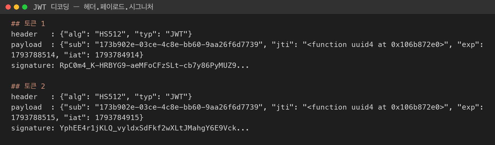
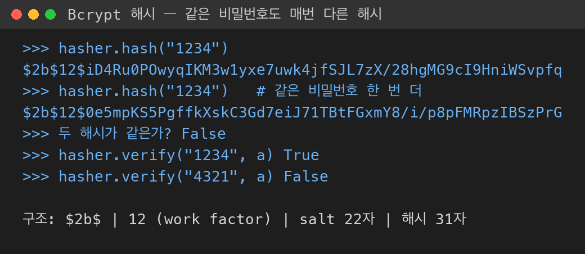
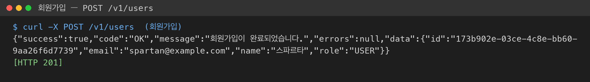
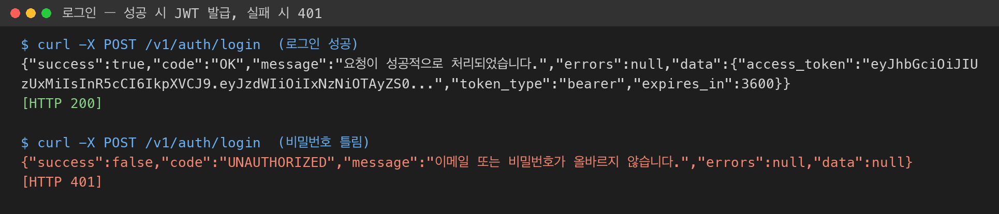
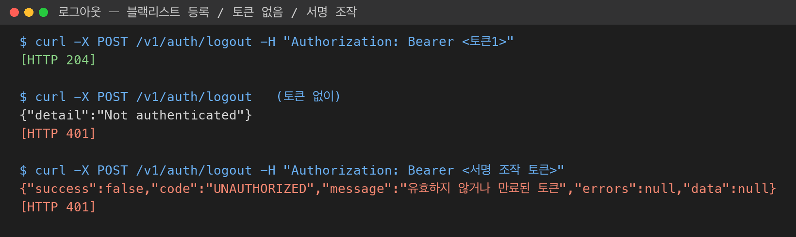
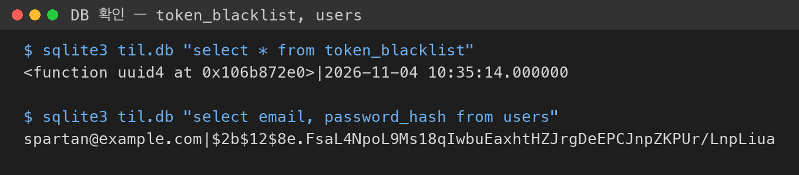

# 인증과 인가

### 인증(Authentication) vs 인가(Authorization)

| 구분 | 인증 | 인가 |
| --- | --- | --- |
| 질문 | 너 누구야? (신원 확인) | 이거 해도 돼? (권한 확인) |
| 예시 | 이메일/비밀번호 로그인 | 관리자만 접근, 본인 글만 수정 |
| 시점 | 로그인할 때 | 요청할 때마다 |

- 실습 코드에서 인증은 `AuthService.login()`, 인가는 `resolve_require_admin()`(role이 ADMIN인지 검사)이 담당함
- 인증 실패는 **401**, 인가 실패(로그인은 했지만 권한 없음)는 **403**으로 구분함

<br>

### 세션(Stateful) vs 토큰(Stateless)

| 비교 | 세션 | 토큰 (JWT) |
| --- | --- | --- |
| 로그인 상태 저장 | 서버가 보관 | 서버는 저장 안 함, 토큰에 정보가 들어 있음 |
| 서버 부담 | 접속자 늘수록 메모리 증가 | 서명 검증 계산만 함 |
| 서버 여러 대 | 세션 공유 장치 필요 | 같은 비밀키만 있으면 어디서든 검증 가능 |
| 강제 로그아웃 | 세션 지우면 끝 | 만료 전까지 회수 어려움 → **블랙리스트** 필요 |

<br>

## JWT ( JSON WEB TOKEN )

- 기본 정보를 토큰에 포함 ( 회원 식별 ID, 만료 시간, 발행 시간, ...)
- DB에 기록할 필요가 없음
- 구조 : 헤더.페이로드.시그니처

### 헤더

- 알고리즘 유형 (aig) : 암호화 방식
- 토큰 유형 (JWT)

### 페이로드

#### 토큰에 포함된 데이터

- sub : 식별자ID - 회원ID
- jti : 토큰식별자ID
- exp : 토큰 유효시간
- iat : 토큰 발급일시

> 페이로드는 암호화가 아니라 Base64 변환만 된 것이라 **누구나 읽을 수 있음** → 비밀번호 같은 민감 정보는 넣지 않음

### 시그니처

- 데이터의 변조 검증용
- 시그니처 문자열
- 서버 비밀키 + 메세지|데이터
- HASH -> HMAC
- SHA256/512 + 메시지

#### 실제 발급된 토큰 디코딩

- 로그인으로 받은 토큰을 `.` 기준으로 나눠 Base64 디코딩해 봄
- 헤더에 `HS512`, 페이로드에 `sub`, `jti`, `exp`, `iat`가 들어 있는 것을 확인함



> ⚠️ **토큰 1과 토큰 2의 `jti`가 똑같음** (`"<function uuid4 at 0x...>"`)
> - 원인: `security.py`에서 `uuid.uuid4` 함수를 **호출하지 않고** 함수 자체를 문자열로 바꿈
> - 결과: 모든 토큰의 jti가 같아져서, 한 사람이 로그아웃하면 jti 기준으로 **다른 모든 토큰도 블랙리스트에 걸림**
> - 해결 방향: 함수 뒤에 무엇을 붙여야 "실행 결과"가 되는지 확인해 보기

<br>

## pyJWT

### 암호화
#### 양방향 ( 복호화 가능 )
- 암호화 <-> 복호화
- AES, ARIA

#### 단방향 ( 복호화 불가능 )
- 해시 : md5, SAH256/512 ...
- 고정 해시 : 같은 값 -> 같은 해시
    - 무차별 대입 -> 원자값을 추측 -> 보안상 미사용 (인증 X) -> 데이터 변조 검증에 사용

- 유동 해시 : 
    - 같은 값이어도 매번 다른 해시가 나옴 → 비밀번호 저장에 사용 (bcrypt)
    - **Salt**: 해싱 직전에 붙이는 랜덤 문자열 → 같은 `1234`도 저장값이 달라짐
    - **Work Factor**: 계산 반복 횟수를 일부러 늘려 무차별 대입 속도를 늦춤 (`$2b$12$` 의 12)
    - 검증은 저장된 해시 안의 salt를 꺼내 다시 해싱해서 비교함 (`bcrypt.checkpw`)

#### user/infrastructure/security.py

```python
class BcryptPasswordHasher(PasswordHasher):
    def hash(self, raw_password: str) -> str:
        pwd_bytes = raw_password.encode("utf-8")
        salt = bcrypt.gensalt()
        hashed = bcrypt.hashpw(pwd_bytes, salt)
        return hashed.decode("utf-8")

    def verify(self, raw_password: str, hashed_password: str) -> bool:
        pwd_bytes = raw_password.encode("utf-8")
        hashed_bytes = hashed_password.encode("utf-8")
        return bcrypt.checkpw(pwd_bytes, hashed_bytes)
```

- bcrypt는 bytes를 다루므로 `encode` / `decode`로 str ↔ bytes 변환함
- domain의 `PasswordHasher`(추상 클래스)를 infrastructure에서 bcrypt로 구현함 → 나중에 argon2 등으로 바꿔도 service 코드는 그대로



<br>

# 실습: JWT 로그인 / 로그아웃 (backend_project_ax1_auth)

### 전체 흐름

```
회원가입  POST /v1/users        → 비밀번호 bcrypt 해싱 후 저장
로그인    POST /v1/auth/login   → 이메일·비밀번호 검증 → JWT 발급
로그아웃  POST /v1/auth/logout  → Authorization: Bearer <토큰> → jti를 블랙리스트에 등록
```

<br>

### 회원가입

- 응답에 `password_hash`는 포함하지 않음 (UserResponse 스키마로 걸러냄)



<br>

### 로그인 (AuthService.login)

#### auth/application/service.py

```python
async def login(self, email: str, plain_password: str) -> tuple[str, str, int]:
    user_id = await self._credential_verifier.verify_credentials(email, plain_password)
    if not user_id:
        raise UnauthorizedException("이메일 또는 비밀번호가 올바르지 않습니다.")

    token, _, _, expires_in = self._token_provider.create_access_token(user_id)
    return token, "bearer", expires_in
```

- 이메일이 없을 때와 비밀번호가 틀렸을 때 **같은 메시지**를 돌려줌 → 어떤 이메일이 가입돼 있는지 알려주지 않기 위해
- service는 `TokenProvider`, `UserCredentialVerifier` 같은 **추상 클래스**만 알고, 실제 구현(JWT, bcrypt)은 wiring에서 주입됨



#### auth/infrastructure/security.py (토큰 발급)

```python
payload = {
    "sub" : str(user_id),
    "jti" : jti,
    "exp" : expired_at,
    "iat" : now
}
encoded_jwt = jwt.encode(payload, self.secret_key, algorithm=self.algorithm)
```

- `jwt.decode()`는 서명이 안 맞거나 `exp`가 지나면 `PyJWTError`를 던짐 → `UnauthorizedException`(401)으로 바꿈

<br>

### 로그아웃과 블랙리스트

- JWT는 서버가 저장하지 않으므로 로그아웃해도 만료 전까지 토큰이 살아 있음
- 그래서 로그아웃한 토큰의 **jti만** `token_blacklist` 테이블에 저장하고, 요청마다 블랙리스트에 있는지 확인함

| 방식 | 저장하는 것 | 특징 |
| --- | --- | --- |
| 화이트리스트 | 허용된 토큰 전부 | 로그인마다 저장해야 함 |
| 블랙리스트 | 로그아웃된 토큰만 | Stateless 장점 유지, 구현 간단 |

#### auth/application/service.py

```python
async def logout(self, token: str) -> None:
    payload = self._token_provider.decode_token(token)
    if not await self._blacklist_repo.is_blacklisted(payload.jti):
        await self._blacklist_repo.add(jti=payload.jti, expired_at=payload.exp)
    now = datetime.now(timezone.utc)
    await self._blacklist_repo.cleanup_expired(now)
```

- `expired_at`을 같이 저장하는 이유: 토큰이 원래 만료되면 블랙리스트에 둘 필요가 없으므로 `cleanup_expired()`로 지움 → 테이블이 계속 커지지 않음
- 토큰 없이 요청하면 `HTTPBearer`가 막고, 서명을 조작한 토큰은 `decode`에서 401이 됨





- DB에는 비밀번호 원문이 아니라 `$2b$12$...` 해시만 저장된 것을 확인함

<br>

### wiring으로 의존성 주입

- 라우터는 `Depends(provide_auth_service)` 껍데기만 의존함
- `wiring/auth.py`의 `create_auth_service()`가 JWT 구현체, bcrypt, SQLAlchemy 저장소를 조립하고 `dependency_overrides`로 교체함
- 4계층 구조 덕분에 auth 도메인이 user 도메인의 `UserRepository`, `PasswordHasher`를 **인터페이스로만** 가져다 씀

> ⚠️ `wiring/user.py`에서 `get_current_user`, `require_admin` override가 주석 처리되어 있음
> - 이 상태로 `GET /v1/users/me`를 호출하면 `NotImplementedError`가 그대로 나서 500이 됨
> - 해결 방향: 주석을 풀어서 `resolve_current_user`가 연결되는지 확인해 보기

<br>

### 💭 정리

**JWT는 서버가 기억하지 않는 대신, 서명으로 위조를 막고 블랙리스트로 로그아웃을 보완함**

- 비밀번호는 bcrypt(유동 해시 + salt)로 저장하고, 검증은 `checkpw`로만 함
- 페이로드는 누구나 읽을 수 있으니 식별자(`sub`, `jti`)와 시간 정보만 넣음
- 로그아웃은 토큰 전체가 아니라 `jti`를 블랙리스트에 등록하고, 만료된 항목은 정리함
