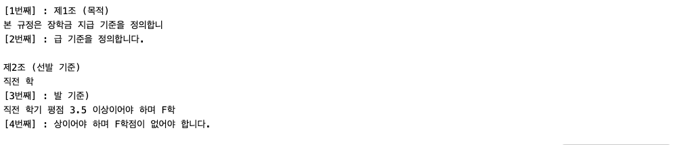
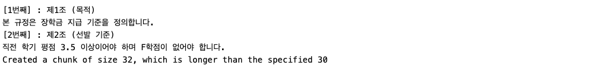

# 11.13 / Fri

# DQ REVIEW

1. LLM이 사전 학습된 데이터의 범위를 벗어난 최신 사건이나 비공개 정보에 대해 알지 못하는 한계
   - 지식 컷오프
2. 교안에서 설명하는 RAG(검색 증강 생성)의 핵심 동작 방식으로 가장 적절한 것
   - 답변 생성 전 외부 문서에서 관련 근거를 검색하여 프롬프트에 주입
3. 사용자가 질문을 입력하기 전에 문서를 수집,분할,임베딩하여 벡터 저장소에 저장해두는 사전 준비 단계
   - ETL, 인덱싱
4. 텍스트 분할(Chunking)시 앞뒤 청크 사이에 Chunk_overlap(중복 구간)을 설정하는 주된 목적
   - 문장이 잘려 문장의 문맥이나 의미가 단절되는 현상을 방지 하기 위해
5. 검색기(Retriever)가 질문과 관련된 정확한 문서를 찾아 전달해 주었음에도, 모델이 해당 문서를 무시하고 사실이 아닌 답변을 출력했다면 이는 RAG 5단계 중 어느 단계의 병목에 해당하는가
   - 생성 단계

# 1-3 임베딩 & 벡터

## 임베딩과 벡터 표현의 원리

#### 텍스트 수치화 및 의미 공간 ( Semantic Space )

- 자연어 처리의 한계 : 컴퓨터는 문자 자체를 이해가 불가능해서 숫자로 변환 필요
- 의미 공간의 배치 : 의미가 유사한 문장은 다차원 공간에서 근접한 좌표에 위치
- 의미적 연산 : 단어와 문장 간 관계를 거리와 각도로 측정 가능

#### 계산법

- 유클리언 거리법 : 0 ~ 무한 에서 0에 가까울수록 유사
- 코사인 유사도 : -1 ~ 1 사이에서 1에 가까울수록 유사도가 높으며 / 0에 가까울수록 유사도가 낮아짐 / -1에 가까울수록 반대 의미를 뜻함

## 임베딩 모델 종류 & 선택 기준

- 임베딩 모델의 벡터 차원 수와 연산 속도는 검색의 정확도뿐만 아니라 벡터 DB 용량 및 운영 비용에 직접적 영향 미침
- 임베딩 단계에서 텍스트의 의미가 왜곡되거나 손실되면 엉뚱한 문서가 검색되어, 파이프라인 전체의 답변 품질을 떨어뜨리는 병목 지점 됨

### 임베딩 모델 규격 비교

- 차원 수가 클수록 의미 표현력이 정교해지지만, 저장 공간과 연산량이 증가합니다.

| 모델명                 | 제공사          | 출력 차원 수 | 최대 입력 토큰 | 주요 권장 용도                       |
| ---------------------- | --------------- | ------------ | -------------- | ------------------------------------ |
| text-embedding-3-small | OpenAI          | 1,536차원    | 8,191 토큰     | 범용 검색, 비용 효율적 시스템 구축   |
| text-embedding-3-large | OpenAI          | 3,072차원    | 8,191 토큰     | 고정밀 법률·의료 전문 문서 검색      |
| bge-m3                 | BAAI (오픈소스) | 1,024차원    | 8,192 토큰     | 로컬 보안 환경 및 다국어 지원 시스템 |

### 임베딩 모델 선택 시 고려사항

- 도메인 적합성
  - 전문 용어가 다수 포함된 문서는 해당 분야 용어를 학습한 모델을 채택해야 매칭 오류가 줄어듬
- 인프라 비용
  - 차원이 높을 수록 벡터 데이터베이스의 메모리 사용량과 인덱싱 비용이 선형적으로 증가
- 다국어 지원 능력
  - 한국어 문서의 어순과 의미를 정확히 반영하는 다국어 특화 모델인지 사전에 검증해야 함

### 키워드

- 임베딩 ( Embedding ) : 텍스트의 의미를 고차원 공간 상의 숫자 배열(벡터)로 변환하는 핵심 전처리 작업
- 차원 ( Dimension) : 문장의 복합적인 의미를 수치화하기 위해 모델이 사용하는 기준 축의 총 개수
- 코사인 유사도 ( Cosine Similarity) : 벡터 사이의 각도를 측정하여 문장의 의미적 유사성을 판별하는 척도

```jsx
# OpenAI 임베딩 모델 호출 및 벡터 추출

import os
from dotenv import load_dotenv
from langchain_openai import OpenAIEmbeddings
import numpy as np

load_dotenv()

embeddings_model = OpenAIEmbeddings(model="text-embedding-3-small")

# 임베딩 할 예시 문장 정의
sample_text = "인공지능 모델이 문장의 의미를 이해하기 위해 숫자로 변환"

# 텍스트를 고차원 배열 (벡터)로 변환
vector_data = embeddings_model.embed_query(sample_text)

# 생성된 벡터의 전체 길이(차원 수)를 출력
print(f"생성된 벡터의 차원 수 : {len(vector_data)}")

# 벡터 내부의 실수 값 중 앞부분 5개만 출력
print(f"변환된 벡터 앞부분 5개 : {vector_data[:5]}")
```

<aside>

생성된 벡터의 차원 수 : 1536
변환된 벡터 앞부분 5개 : [-0.004138946533203125, 0.041961669921875, -0.00598907470703125, 0.01427459716796875, -0.00327301025390625]

</aside>

# 1-4 벡터 유사도 검색 원리

### 벡터 유사도 ( Vector Similarity )

- 텍스트를 변환한 고차원 숫자 배열(벡터) 강의 거리와 각도를 수학적으로 측정, 의미적 유사성을 판별하는 핵심 척도

### 유사도 및 거리 측정 방식 비교

- 코사인 유사도 ( Cosine Similarity )
  - 두 벡터 사이의 각도 코사인 값을 측정
  - 값의 범위는 -1 ~ 1 사이
  - 문서 길이 차이에 따른 왜곡이 없어 자연어 검색에서 가장 표준적
- 유클라디안 거리 ( Euclidean Distance )
  - 두 벡터 끝점 사이의 최단 직선거리 측정
  - 값이 0에 가까울수록 두 데이터가 유사함
- 내적 ( Dot Product )
  - 두 벡터의 방향과 크기를 동시에 반영하는 연산
  - 단위 벡터로 정규화된 상태에서는 코사인 유사도와 수학적으로 동일한 결과
  | **척도명**          | **주요 계산 대상**                  | **결과 범위**        | **자연어 처리 활용**                         |
  | ------------------- | ----------------------------------- | -------------------- | -------------------------------------------- |
  | **코사인 유사도**   | 두 벡터 사잇각의 방향 일치도        | -1 ~ 1               | 문서 길이와 무관하게 주제 유사성 판단에 최적 |
  | **유클리디안 거리** | 공간 상 두 점 사이의 직선거리       | 0 ~ $\infty$         | 물리적 거리 측정, 크기 차이가 중요한 데이터  |
  | **내적**            | 방향의 일치도 및 벡터의 절대적 크기 | $-\infty$ ~ $\infty$ | 정규화된 임베딩 환경에서 초고속 유사도 계산  |
  ### ANN ( 근사 최근접 이웃 ) 검색 & 벡터 인데긋
  - Approximate Nearest Neighbor
    - 대규모 벡터 공간에서 전수 조사를 피함
    - 오차 범위를 허용하며 탐색 속도를 수천 배 향상 시키는 고속 색인 기술
  #### 완전 탐색 ( K-NN )의 한계 & 병목
  - 전수 조사 방식
    - 모든 저장 벡터와 질의 벡터 간 거리를 일일이 비교
    - 데이터가 늘어날수록 연산량이 선형적으로 증가
  - 성능 저하
    - 수백만 건 이상의 문서가 누적된 운영 환경에서는 질의 지연 시간이 급증
    - 실시간 서빙이 불가능해짐

# 1-5 청킹

- 방대한 텍스트 문서를 정보의 손실 없이 처리할 수 있도록 일정한 크기의 조각(Chunk)으로 나누는 작업

### 청킹이 필요한 이유

- 입력 창 크기의 한계
  - 언어 모델과 임베딩 모델은 한 번에 입력받을 수 있는 최대 토큰 수가 정해져 있음
- 의미의 선명도 유지
  - 너무 긴 문서를 통째로 임베딩하면 여러 주제가 섞여 벡터의 의미 표현력이 약화 됨
- 검색 효율성 극대화
  - 질문과 연관성이 높은 핵심 문단만 선별하여 인공지능에게 전달하므로 응답 속도와 정확도가 올라감

### 주요 청킹 분할 전략

- 분할 전력 ( Splitting Strategy )
  - 문서를 자르는 기준에 따라 고정 크기, 재귀적 문자, 의미론적 분할 방식으로 구분

#### 고정 크기 분할 ( Character Text Splitter )

- 지정된 글자 수로 분할하여 연산 속도는 매우 빠르나, 단어/문맥 단절로 검색 정확도를 떨어뜨리는 한계가 존재

```python
text_spliiter = CharacterTextSplitter(
    separator="", # 특정 구분자 없이 글자 수 단위로 분할
    chunk_size=30, # 청크 1개의 최대 글자 수 지정
    chunk_overlap=10, # 앞 청크의 마지막 내용을 가져옴
)

# 텍스트를 분할하여 리스트 형태로 반환
text_chunks = text_spliiter.split_text(campus_rules)

for i, chunk in enumerate(text_chunks, 1):
    print(f"[{i}번째] :{chunk}")
```



```python
text_spliiter = CharacterTextSplitter(
    # separator="", # 특정 구분자 없이 글자 수 단위로 분할
    chunk_size=30, # 청크 1개의 최대 글자 수 지정
    chunk_overlap=10, # 앞 청크의 마지막 내용을 가져옴
)

# 텍스트를 분할하여 리스트 형태로 반환
text_chunks = text_spliiter.split_text(campus_rules)

for i, chunk in enumerate(text_chunks, 1):
    print(f"[{i}번째] :{chunk}")
```



### Separaotor 옵션

- 순서 : “”, “”, ” “,”.”

| separator  | 자르는 위치      | 결과                                                                |
| ---------- | ---------------- | ------------------------------------------------------------------- |
| “”         | 글자 사이 어디든 | chunk_size에 맞춰 정확히 잘림. 대신 단어나 문장 중간이 끊길 수 있음 |
| “”(기본값) | 문단 사이        | 문단 단위라 의미가 잘 유지됨                                        |
| “”         | 줄바꿈           | 줄 단위로 잘림                                                      |
| ” ”        | 띄어쓰기         | 단어 단위로 잘림                                                    |
| “.”        | 마침표           | 대략 문장 단위로 잘림                                               |

### 재귀적 문자 분할 ( Recursive Character Text Splitter )

- 문단/문장/공백 순으로 구분자를 단계 적용해 의미 단위를 온전이 보존
- 범용 텍스트 처리에 가장 최적화된 표준 청킹 방식

```python
rec_splitter = RecursiveCharacterTextSplitter(
    chunk_size=30,
    chunk_overlap=10,
)

rec_chunks = rec_splitter.split_text(campus_rules)

for i, chunk in enumerate(rec_chunks, 1):
    print(f"[{i}번째] :{chunk}")
```


## 1-6 메타데이터

- 데이터 조각에 부착하는 규격화된 신분증
- 본문 텍스트 외에 출처, 생성 일자, 작성자, 카테고리 등을 기록하여 데이터의 맥락을 보존

#### 메타데이터가 필요한 기술적 배경

- 시간적 유효성 구분
  - 동일한 규정이라도 구버전 & 최신 개정안을 날짜 필드로 명확히 분리
- 문서 출처 추적성
  - 모델이 답변을 생성했을 때 원본 문서의 위치와 근거 페이지 입증
- 검색 연산 비용 절감
  - 전체 조각을 벡터 비교하지 않음
  - 조건에 맞는 데이터만 선별하여 처리 속도 높임

### 메타데이터 3대 분류 체계

<aside>

| **분류**                   | **주요 속성 예시**                 | **역할 및 검색 시 이점**                         |
| -------------------------- | ---------------------------------- | ------------------------------------------------ |
| **식별 정보 (Identity)**   | `source`, `doc_id`, `author`       | 문서의 출처를 명시하고 답변의 인용 근거를 제시함 |
| **시간 정보 (Temporal)**   | `created_at`, `updated_at`, `year` | 구버전 정보 배제 및 최신 유효 문서 우선 선별     |
| **구조 정보 (Structural)** | `section`, `page`, `chunk_id`      | 원본 문서 내 위치 파악 및 인접 문맥 역추적 가능  |

</aside>

### 메타데이터 필터링

- 검색 대상의 범위를 좁히는 목적
- 전체 데이터를 탐색하지 않고 조건에 일치하는 데이터만 선별, 검색 정확도 극대화

#### 필터링 메커니즘 ( 사전 vs 사후 )

- 사전 필터링 ( Pre - filtering )
  - 메타데이터 조건을 충족하는 청크만 먼저 걸러낸 뒤 유사도 계산 수행
- 사후 필터링 ( Post - filtering)

### 문서 로딩

#### 필요한 이유

- 포맷의 이질적 해소
  - PDF, 웹페이지,워드 문서는 저장 구조가 달라 모델이 직접 읽을 수 없음
- 표준화된 규격 변환
  - 모든 입력 데이터를 page_content(본문)와 metadata(속성) 구조로 일원화
- 파이프라인 연속성 보장
  - 설계한 메타데이터 기반 필터링 및 청킹 작업을 수행하기 위한 필수 전제 조건
