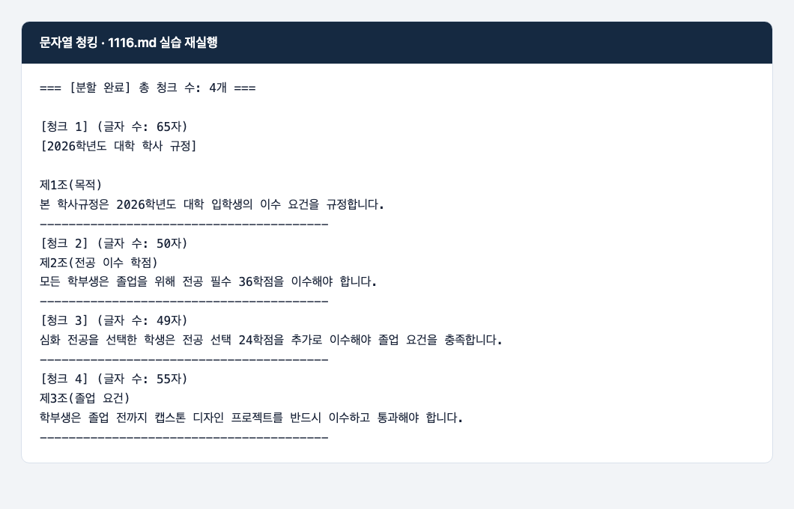
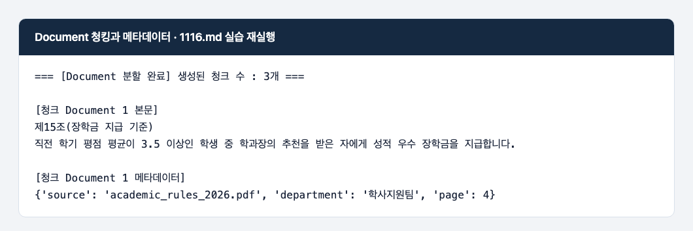
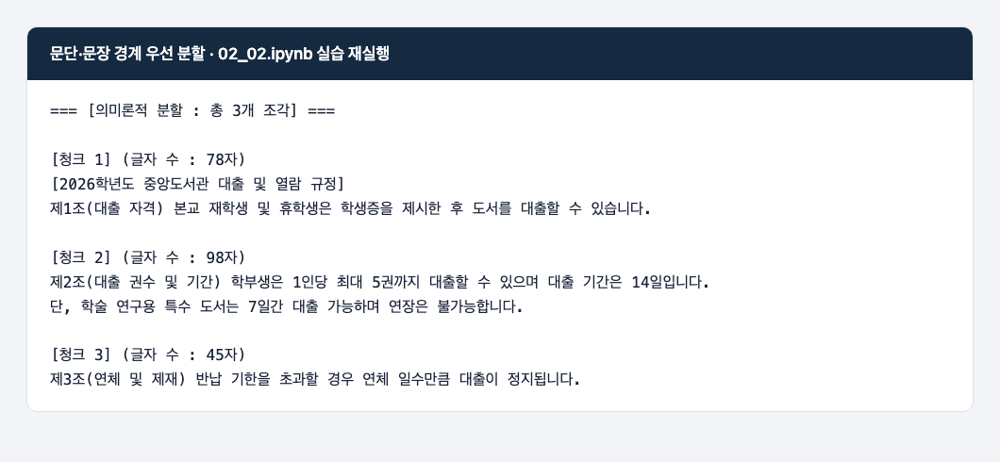
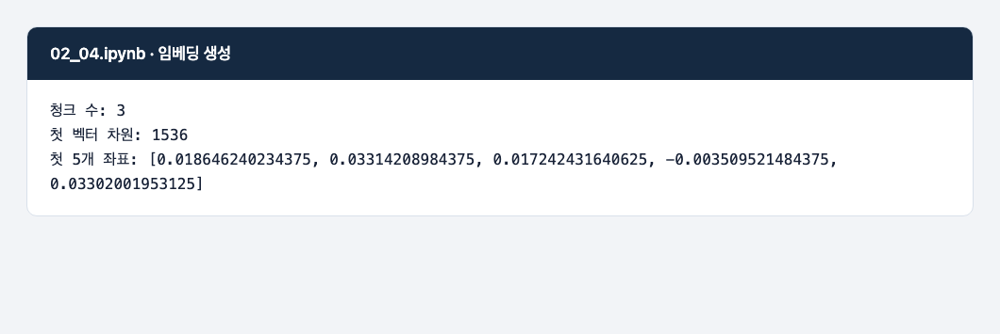
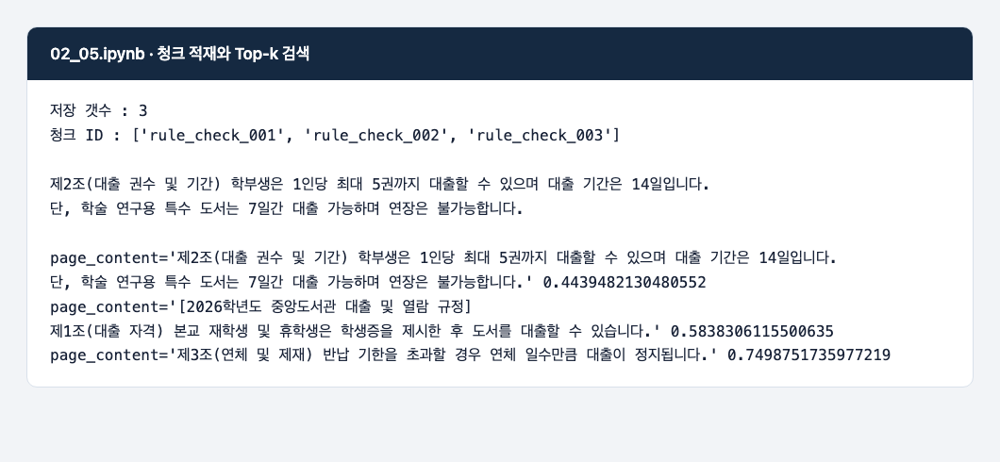
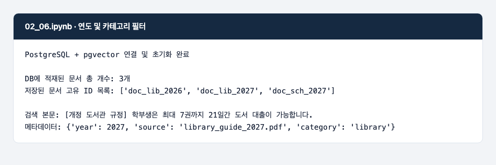
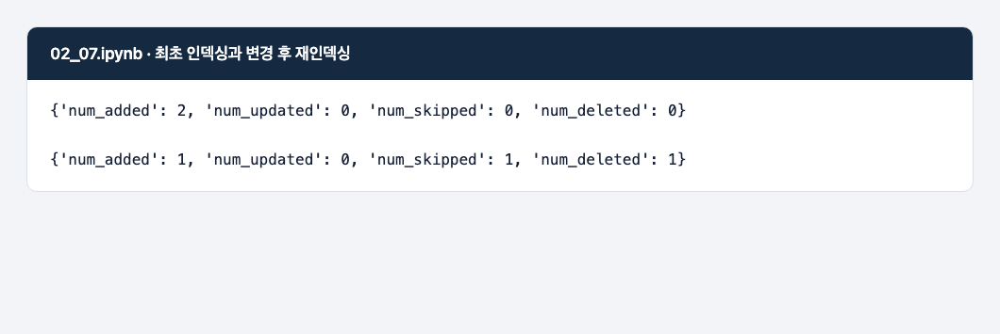

# 11.16 / Mon

## 텍스트 청킹

- 로딩된 긴 문서를 검색과 언어 모델 처리에 가장 적합한 단위인 텍스트 조각(Chunk)으로 분할하는 작업

### 청킹이 필요한 기술적 배경

- 입력 용량 한계 극복
  - 언어 모델이 한 번에 읽을 수 있는 토큰 수의 한계를 넘지 않도록 문서를 적절한 크기로 재단
- 검색 집중도 향상
  - 전체 문서를 한 번에 검색하는 것보다 특정 주제가 담긴 조각 단위로 검색할 때 연관성이 훨씬 높아짐
- 인덱싱 연속성 확보
  - 적재한 Document를 향후 임베딩 모델에 전달하기 위한 필수 선행 단계

#### LangChain Text Splitter 동작 원리

- split_text()
  - 순수 문자열을 입력받아 지정된 기준에 맞춰 분할된 문자열 리스트 생성
- split_documents()
  - Document 객체 리스트를 입력받아 분할하며, 원본에 부여된 metadata를 모든 분할 조각에 자동 복제

### 핵심 파라미터 설계 & 시각화

#### 청크 파라미터 기준 설정

- chunk_size : 하나의 청크가 가질 수 있는 길이 상한. 이 예제는 `length_function=len`이므로 문자 수 기준
- chunk_overlap : 연속된 두 청크 사이에 겹치도록 지정한 문자 수. 구분자 배치에 따라 실제 겹침은 더 짧을 수 있음
- 문맥 보존의 목적 : 문장이 중간에 잘려 주어와 목적어가 단절되는 현상을 방지하기 위해 앞 청크의 끝 부분을 청크의 앞부분에 중복 배치

```python
# langchain_text_splitters 패키지에서 재귀적 텍스트 분할기를 가져옵니다.
from langchain_text_splitters import RecursiveCharacterTextSplitter

# 분할 실습을 위한 2026학년도 학사 규정 예시 텍스트를 선언합니다.
sample_text = (
    "[2026학년도 대학 학사 규정]\n\n"
    "제1조(목적)\n본 학사규정은 2026학년도 대학 입학생의 이수 요건을 규정합니다.\n\n"
    "제2조(전공 이수 학점)\n모든 학부생은 졸업을 위해 전공 필수 36학점을 이수해야 합니다.\n"
    "심화 전공을 선택한 학생은 전공 선택 24학점을 추가로 이수해야 졸업 요건을 충족합니다.\n\n"
    "제3조(졸업 요건)\n학부생은 졸업 전까지 캡스톤 디자인 프로젝트를 반드시 이수하고 통과해야 합니다."
)

# 청크 크기 80자, 겹침 20자로 분할기 규칙을 설정합니다.
text_splitter = RecursiveCharacterTextSplitter(
    chunk_size=80,  # 각 청크의 최대 길이를 80자로 제한합니다.
    chunk_overlap=20,   # 문맥 단절을 방지하기 위해 앞뒤 20자를 겹치도록 설정합니다.
    length_function=len,    # 글자 수를 측정하는 함수로 파이썬 내장 len을 지정합니다.
    is_separator_regex=False    # 구분자를 정규표현식이 아닌 일반 문자열로 처리합니다.
)

# 텍스트를 청크 단위 리스트로 분할합니다.
chunks = text_splitter.split_text(sample_text)

# 분할된 전체 조각 수를 확인합니다.
print(f"=== [분할 완료] 총 청크 수: {len(chunks)}개 ===\n")

# 각 조각의 내용과 길이를 순서대로 출력합니다.
for index, chunk in enumerate(chunks):
    print(f"[청크 {index + 1}] (글자 수: {len(chunk)}자)")
    print(chunk)
    print("-" * 40)
```



```python
from langchain_core.documents import Document

source_document = Document(
    page_content=(
        "제15조(장학금 지급 기준)\n"
        "직전 학기 평점 평균이 3.5 이상인 학생 중 학과장의 추천을 받은 자에게 성적 우수 장학금을 지급합니다.\n"
        "단, 징계 처분을 받은 사실이 있는 학생은 선발 대상에서 제외됩니다.\n\n"
        "제16조(신청 절차)\n"
        "장학금 신청서와 관련 증빙 서류는 매 학기 개강 2주 전까지 학사지원팀에 제출해야 합니다."
    ),
    metadata={
        "source": "academic_rules_2026.pdf",
        "department": "학사지원팀",
        "page": 4
    }
)

# Document 리스트 전달하여 청크 Document 리스트로 분할
split_documents = text_splitter.split_documents([source_document])

# 분할된 총 Document 조각 수 출력
print(f"=== [Document 분할 완료] 생성된 청크 수 : {len(split_documents)}개 ===\n")

# 첫 번째 청크 Document의 본문과 전파된 메타데이터 확인
print("[청크 Document 1 본문]")
print(split_documents[0].page_content)
print("\n[청크 Document 1 메타데이터]")
print(split_documents[0].metadata)
```



```python
# 분할 청크 기반 질의응답

import os
from dotenv import load_dotenv
from langchain.chat_models import init_chat_model
from langchain_core.prompts import ChatPromptTemplate
from langchain_core.output_parsers import StrOutputParser

load_dotenv()

model = init_chat_model(
	model_provider="openai",
	model="gpt-6-luna",
	# temperature=0 # 일관되고 사실적인 출력을 위해 온도을 0으로 고정
)

# 청크 본문과 메타데이터를 모델에 전달할 프롬프트 양식을 구성합니다.
prompt = ChatPromptTemplate.from_messages([
    ("system", (
        "당신은 대학 학사 규정 안내 어시스턴트입니다.\n"
        "제공된 [참고 청크]의 내용에만 근거하여 명확하게 답변하세요.\n"
        "답변 말미에는 반드시 [출처: 파일명 (페이지쪽)] 형식으로 근거를 명시하세요.\n\n"
        "[참고 청크]:\n{context}\n\n"
        "[문서 속성]: 파일={source}, 페이지={page}"
    )),
    ("user", "{question}")
])

# 프롬프트, 언어 모델, 출력 파서를 파이프라인으로 연결
qa_chain = prompt | model | StrOutputParser()

# 분할된 청크 중 장학금 기준이 담긴 첫 번째 조각을 문맥으로 지정
selected_chunk = split_documents[0]
user_question = "성적 우수 장학금을 받기 위한 직전 학기 평점 요건은 어떻게 됨?"

# 체인 실행, 질의 결과 도출
response = qa_chain.invoke({
	"context": selected_chunk.page_content,
	"source": selected_chunk.metadata["source"],
	"page": selected_chunk.metadata["page"],
	"question": user_question
})

print(response)
```


## 2-3 청킹 품질 실험 \* 비교

### 청크 크기별 트레이드 오프

- 작은 청크 크기
  - 세부 정보를 찾는 정밀도가 높음
  - 문맥이 끊겨 주어나 배경 상황을 인공지능이 왜곡하기 쉬움
- 큰 청크 크기
  - 풍부한 문맥을 전달함
  - 핵심 질문과 무관한 노이즈가 유입되어 처리 비용이 늘고 답변 초점이 흐려짐

| 설정 구분            | 장점                        | 단점                             | 적합한 문서 유형                  |
| -------------------- | --------------------------- | -------------------------------- | --------------------------------- |
| 소형 청크 (50~100)   | 단답형 사실 검색에 유리     | 앞뒤 인과관계 유실               | FAQ, 사전, 단순 단어 규정집       |
| 중형 청크 (200~500)  | 문맥과 검색 정밀도의 균형   | 특수한 구조 분석 시 조정 필요    | 일반 학사 규정, 업무 매뉴얼       |
| 대형 청크 (800 이상) | 문맥 보존 및 서사 이해 우수 | 무관한 내용 혼입, 토큰 소모 증가 | 계약서 전문, 법률 조항, 학술 논문 |

### 문단·문장 경계를 우선하는 재귀 분할

- 문단·줄바꿈·마침표·공백 순으로 경계를 우선한다. 이 실습의 방식은 문자 기반 재귀 분할이다.

```python
library_rules = (
    "[2026학년도 중앙도서관 대출 및 열람 규정]\n"
    "제1조(대출 자격) 본교 재학생 및 휴학생은 학생증을 제시한 후 도서를 대출할 수 있습니다.\n"
    "제2조(대출 권수 및 기간) 학부생은 1인당 최대 5권까지 대출할 수 있으며 대출 기간은 14일입니다.\n"
    "단, 학술 연구용 특수 도서는 7일간 대출 가능하며 연장은 불가능합니다.\n"
    "제3조(연체 및 제재) 반납 기한을 초과할 경우 연체 일수만큼 대출이 정지됩니다."
)

semantic_splitter = RecursiveCharacterTextSplitter(
    chunk_size=120,
    chunk_overlap=20,
    # 문단 바꿈 -> 줄 바꿈 -> 마침표 -> 띄어쓰기 순 구분자 탐색
    separators=["\n\n", "\n", ".", " "],
    is_separator_regex=False # 문자열을 정규식이 아니라 그냥 글자 그대로 취급
)

# 의미론적 분할
semantic_chunks = semantic_splitter.split_text(library_rules)

# 결과
print(f"=== [의미론적 분할 : 총 {len(semantic_chunks)}개 조각] ===")
for idx, chunk in enumerate(semantic_chunks):
    print(f"\n[청크 {idx + 1}] (글자 수 : {len(chunk)}자)")
    print(chunk)
```



## 2-4 임베딩 생성

### 임베딩과 벡터 표현

- 임베딩 모델은 자연어의 의미를 고정 길이 벡터로 변환한다.
- 벡터는 `[-0.012, 0.034, 0.981]`처럼 순서가 있는 숫자 배열이다.
- 차원은 벡터 좌표의 개수다. `text-embedding-3-small`의 기본 출력은 1,536차원이다.

### 임베딩 생성 실습

- `embed_documents()`는 청크 목록을 받아 같은 순서로 벡터를 돌려준다.
- 실습에서는 `text-embedding-3-small`을 사용했다. 입력 청크 수, 벡터의 차원, 앞쪽 좌표 다섯 개를 출력해 결과의 형태를 확인한다. 원본 셀에는 출력문이 없어 확인용으로 추가했다.

```python
library_rule_chunks = [
    "[2026학년도 중앙도서관 대출 및 열람 규정]\n제1조(대출 자격) 본교 재학생 및 휴학생은 학생증을 제시한 후 도서를 대출할 수 있습니다.",
    "제2조(대출 권수 및 기간) 학부생은 1인당 최대 5권까지 대출할 수 있으며 대출 기간은 14일입니다.\n단, 학술 연구용 특수 도서는 7일간 대출 가능하며 연장은 불가능합니다.",
    "제3조(연체 및 제재) 반납 기한을 초과할 경우 연체 일수만큼 대출이 정지됩니다."
]

from langchain_openai import OpenAIEmbeddings

embedding_model = OpenAIEmbeddings(
    model = "text-embedding-3-small"
)

doc_vectors = embedding_model.embed_documents(library_rule_chunks)

print("청크 수:", len(doc_vectors))
print("첫 벡터 차원:", len(doc_vectors[0]))
print("첫 5개 좌표:", doc_vectors[0][:5])
```



## 2-5 PostgreSQL + pgvector 저장과 유사도 검색

- `PGVector`에서 `library_rules` 컬렉션을 만들고 앞의 도서관 규정 청크를 ID와 함께 저장했다. `DATABASE_URL`은 환경 변수로 읽고, `use_jsonb=True`로 메타데이터 저장 방식을 지정했다.
- `similarity_search(..., k=1)`은 가장 가까운 문서 한 건을 반환한다. 같은 질의를 `similarity_search_with_score(..., k=3)`으로 실행하면 문서와 거리 값을 함께 확인할 수 있다. 이 실습의 기본 코사인 거리에서는 값이 작을수록 더 가깝다.
- 질문은 특수 도서의 대출 기간이다. 검색된 규정에는 일반 도서의 14일과 특수 도서의 7일이 같이 나온다. 답을 만들 때 문서 안에서 질문에 해당하는 조건을 읽어야 한다.

```python
import os
from dotenv import load_dotenv
from langchain_openai import OpenAIEmbeddings
from langchain_postgres.vectorstores import PGVector

load_dotenv()

embedding_model = OpenAIEmbeddings(
    model="text-embedding-3-small"
)

connection_url = os.getenv("DATABASE_URL")

vector_store = PGVector(
    embeddings=embedding_model,
    connection=connection_url,
	collection_name="library_rules",
    use_jsonb=True # 메타데이터를 JSONB로 저장
)

chunk_ids = ["rule_check_001", "rule_check_002", "rule_check_003"]

saved_ids = vector_store.add_texts(
    texts=library_rule_chunks,
    ids = chunk_ids
)

print(f'저장 갯수 : {len(saved_ids)}')
print(f'청크 ID : {saved_ids}')

question = "특수 도서는 며칠 동안 대출할 수 있나요?"

search_results = vector_store.similarity_search(
    query=question,
    k=1 # Top-k 설정
)

print(search_results[0].page_content)

search_results2 = vector_store.similarity_search_with_score(
    query=question,
    k=3
)

for chunk, score in search_results2:
    print(chunk, score)
```



## 2-6 메타데이터로 검색 범위 좁히기

- `Document`의 본문과 함께 `source`, `category`, `year`를 저장했다. 이 실습의 컬렉션은 `university_rules`다.
- `filter={"year": 2027, "category": "library"}`를 적용하면 2026년도 도서관 규정과 2027년도 장학금 규정을 제외한다. 남은 2027년도 도서관 규정의 조건은 최대 7권, 21일이다.

```python
import os
from dotenv import load_dotenv
from langchain_openai import OpenAIEmbeddings
# PostgreSQL pgvector 연동 모듈을 불러옵니다.
from langchain_postgres.vectorstores import PGVector

load_dotenv()

embeddings_model = OpenAIEmbeddings(
    model="text-embedding-3-small"
)

# 환경 변수에서 데이터베이스 접속 문자열을 읽어옵니다.
connection_url = os.getenv("DATABASE_URL")

# PGVector 저장소 객체를 생성하고 연결합니다.
vector_store = PGVector(
    embeddings=embeddings_model,     # 임베딩 모델 인스턴스 지정
    collection_name="university_rules", # 데이터를 보관할 컬렉션 테이블 이름
    connection=connection_url,  # 데이터베이스 접속 URL
    use_jsonb=True # 메타데이터를 PostgreSQL JSONB 형태로 저장
)

print("PostgreSQL + pgvector 연결 및 초기화 완료")

# LangChain의 기본 문서 단위인 Document 클래스를 불러옵니다.
from langchain_core.documents import Document

# 설계한 메타데이터 스키마를 적용한 규정 문서 리스트를 생성합니다.
documents_to_insert = [
    # 1번 문서: 2026학년도 도서관 대출 규정
    Document(
        page_content="[도서관 규정] 학부생은 최대 5권까지 14일간 도서 대출이 가능합니다.",
        metadata={
            "source": "library_guide_2026.pdf",
            "category": "library",
            "year": 2026
        }
    ),
    # 2번 문서: 2027학년도 개정 도서관 대출 규정
    Document(
        page_content="[개정 도서관 규정] 학부생은 최대 7권까지 21일간 도서 대출이 가능합니다.",
        metadata={
            "source": "library_guide_2027.pdf",
            "category": "library",
            "year": 2027
        }
    ),
    # 3번 문서: 2027학년도 장학금 규정
    Document(
        page_content="[장학금 규정] 직전 학기 평점 3.5 이상인 학생은 성적 우수 장학금 대상자입니다.",
        metadata={
            "source": "scholarship_2027.pdf",
            "category": "scholarship",
            "year": 2027
        }
    )
]

# 각 문서에 일대일로 매핑될 고유 식별자(ID)를 지정합니다.
document_ids = ["doc_lib_2026", "doc_lib_2027", "doc_sch_2027"]

# Document 객체와 고유 ID를 데이터베이스에 적재(Upsert)합니다.
saved_ids = vector_store.add_documents(
    documents=documents_to_insert,
    ids=document_ids
)

# 저장 완료 결과를 화면에 출력합니다.
print(f"DB에 적재된 문서 총 개수: {len(saved_ids)}개")
print(f"저장된 문서 고유 ID 목록: {saved_ids}")

metadata_filter = {
	"year" : 2027,
	"category" : "library"
}

search_results = vector_store.similarity_search(
	query="최대 대출 일수를 알려주세요",
	k = 1,
	filter=metadata_filter
)

search_doc = search_results[0]
print(f'검색 본문: {search_doc.page_content}')
print(f'메타데이터: {search_doc.metadata}')
```



## 2-7 증분 인덱싱

- 앞 절과 동일한 `university_rules` 컬렉션을 사용했다. `SQLRecordManager`는 어떤 문서를 인덱싱했는지 추적한다. `source_id_key="source"`로 원본을 식별하고 `cleanup="incremental"`로 이번에 들어온 원본의 이전 조각을 정리한다.
- 첫 실행에는 도서관 규정과 장학금 규정 두 건을 넣었다. 두 번째에는 장학금 규정 본문 끝에 공백을 하나 추가했다. 내용이 그대로인 도서관 규정은 건너뛰고, 바뀐 장학금 규정은 새 조각을 추가한 뒤 이전 조각을 제거하는지 확인한다.

```python
from langchain_classic.indexes import SQLRecordManager, index
from langchain_core.documents import Document

# 문서 인덱싱 기록을 추적할 장부(RecordManager)를 생성합니다.
namespace = "pgvector/integrated_university_rules"
record_manager = SQLRecordManager(
    namespace=namespace,
    db_url=connection_url
)

# 데이터베이스 내부에 추적용 테이블 스키마를 생성합니다.
record_manager.create_schema()

# 1차 등록 대상 문서 (2026 규정 및 장학 규정)
initial_documents = [
    Document(
        page_content="[도서관 규정] 학부생은 최대 5권까지 14일간 대출 가능합니다.",
        metadata={"source": "rules_library.txt", "category": "library", "year": 2026}
    ),
    Document(
        page_content="[장학금 규정] 직전 학기 평점 3.5 이상 시 장학금 대상입니다.",
        metadata={"source": "rules_scholarship.txt", "category": "scholarship", "year": 2026}
    )
]

first_result = index(
	docs_source=initial_documents,
	record_manager=record_manager,
	vector_store=vector_store,
	source_id_key="source",
	cleanup="incremental"
)

print(first_result)

initial_documents = [
    Document(
        page_content="[도서관 규정] 학부생은 최대 5권까지 14일간 대출 가능합니다.",
        metadata={"source": "rules_library.txt", "category": "library", "year": 2026}
    ),
    Document(
        page_content="[장학금 규정] 직전 학기 평점 3.5 이상 시 장학금 대상입니다. ",
        metadata={"source": "rules_scholarship.txt", "category": "scholarship", "year": 2026}
    )
]

second_result = index(
	docs_source=initial_documents,
	record_manager=record_manager,
	vector_store=vector_store,
	source_id_key="source",
	cleanup="incremental"
)

print(second_result)
```


