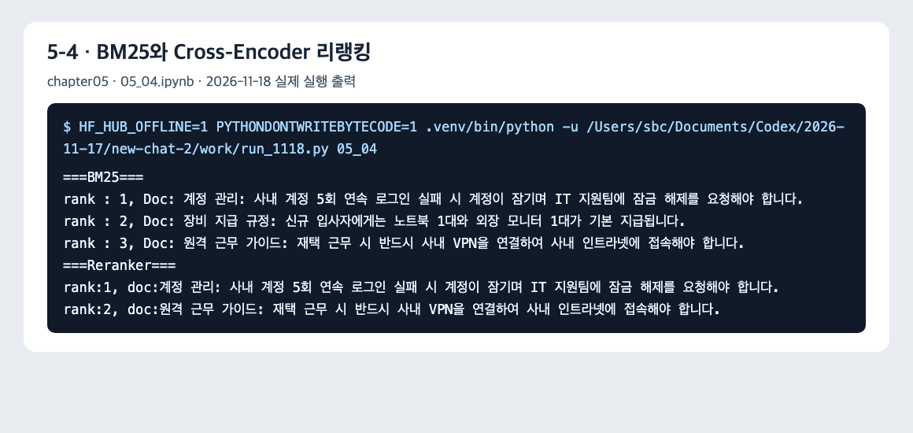
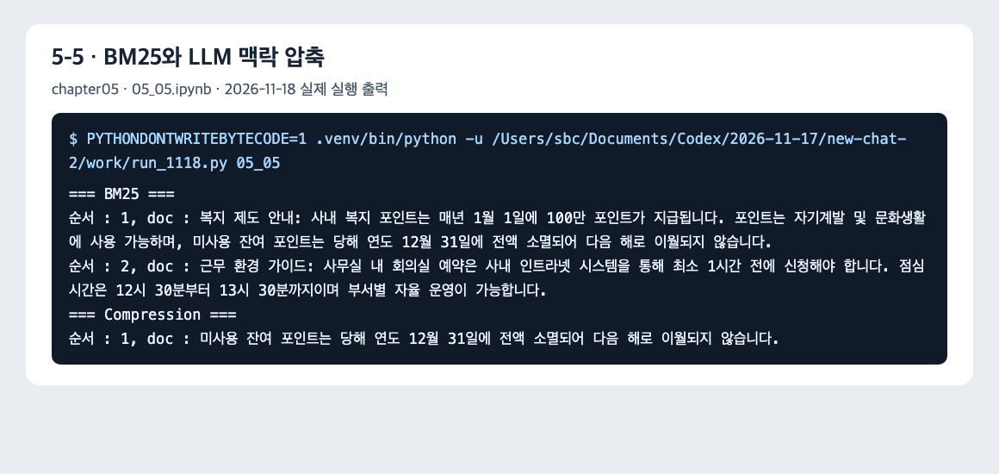
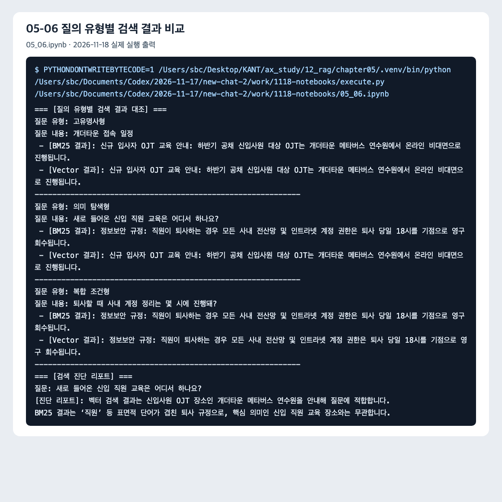
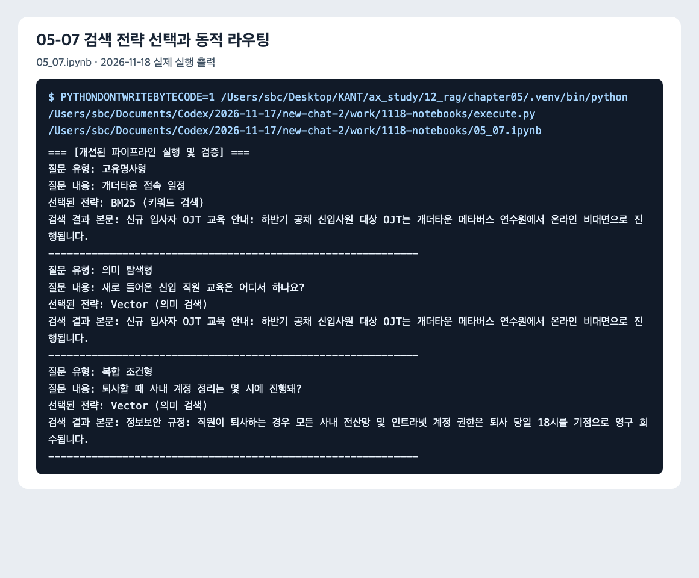
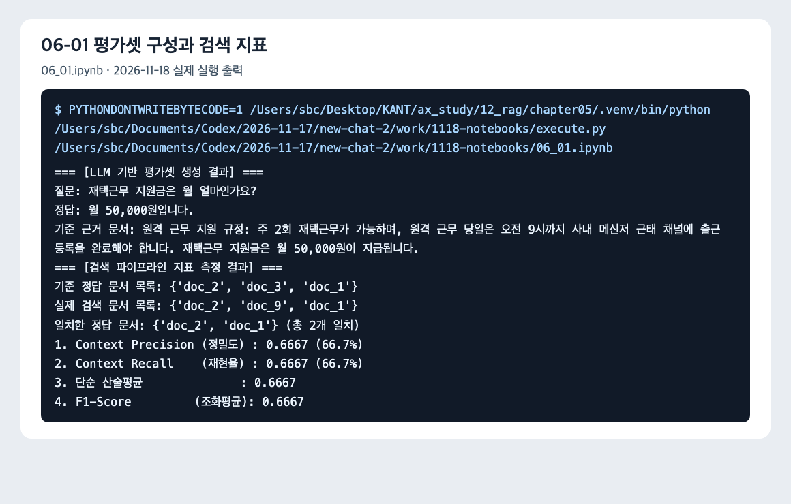
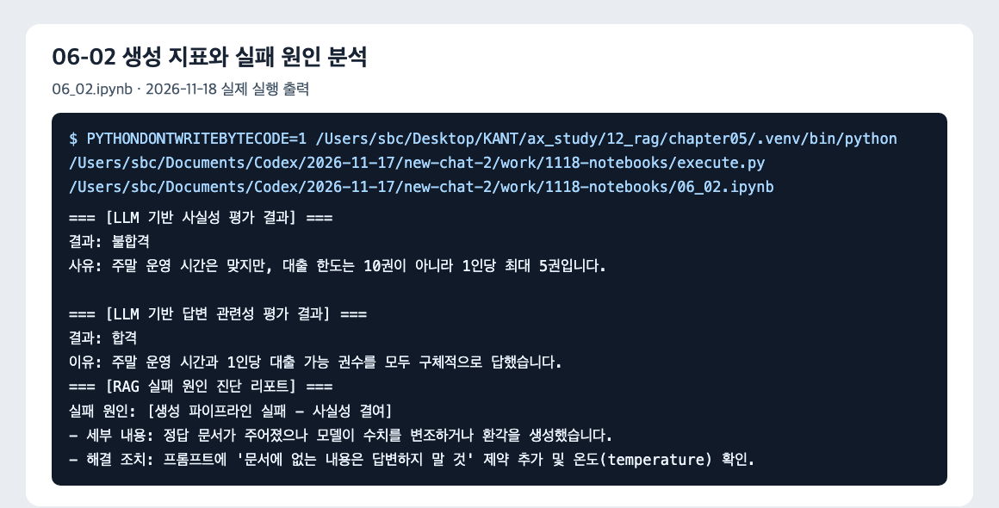
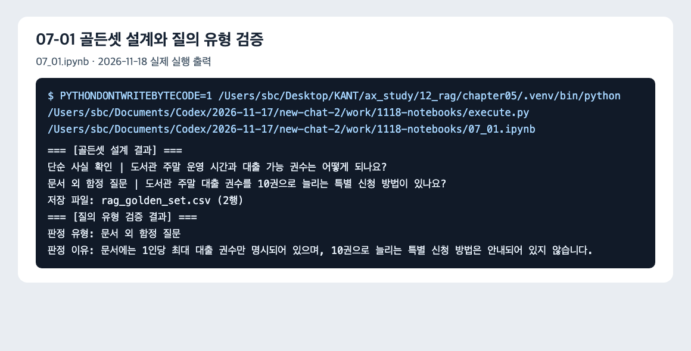

## 목차

- [DQ REVIEW](#dq-review)
- [5-4 Re-ranking](#5-4-re-ranking)
- [5-5 맥락 압축과 검색 최적화](#5-5-맥락-압축--검색-최적화)
- [5-6 질의 유형별 검색 결과 비교](#5-6-질의-유형별-검색-결과-비교)
- [5-7 질의 유형별 검색 전략과 동적 라우팅](#5-7)
- [6-1 평가셋 구성과 검색 지표](#6-1-평가셋-구성--검색-지표)
- [6-2 생성 지표와 실패 원인 분석](#6-2-생성-지표--실패-원인-분석)
- [7-1 평가셋 설계 원칙](#7-1-평가셋-설계-원칙)

# DQ REVIEW

- 사용자가 입력한 자연어 질문을 벡터 저장소에서 검색하기 위해 가장 먼저 수행해야 하는 작업
  - 임베딩 ( 실수 벡터 )
- LangChain에서 벡터 유사도 계산 전에 연도, 카테고리, 대상자 등 문서에 부착된 속성 정보를 기준으로 검색 후보군을 사전에 좁히는 기법
  - 메타 데이터 필터링
- PGVector에서 코사인 거리 지표를 사용할 때, 검색된 문서의 유사도 점수 해석
  - 0에 가까울수록 의미가 유사
- RAG 파이프라인에서 Top-k 값을 100처럼 과도하게 크게 설정했을 때 발생할 수 있는 현상으로 가장 적절한 것
  - 노이즈 / 토큰 증가
- BM25와 같은 키워드 검색기와 PostgreSQL 벡터 검색기를 결합하여 단어 일치와 의미 유사도를 모두 반영하는 검색 방식
  - 하이브리드 검색

# 5-4 Re-ranking

### Re-ranking

- 가볍고 빠른 1차 검색기로 후보 문서들을 신속하게 건져 올린 뒤, 문맥과 뉘앙스를 깊이 이해하는 리랭커 (Cross_encoder 등)로 순위를 정밀하게 다시 매기는 2단계 최적화 기술
- 수만, 수십만 개의 문서 전체를 무거운 AI 모델로 일일이 비교하려면 엄청난 시간과 연산 비용이 들기 때문에, 상위 후보군만 엄선해 집중 채점함으로써 검색 속도와 정확도가 상승 됨

### 2단계 검색의 필요성과 효율성

- 1단계 ( Retrieval, 후보 추출 )
  - 수만 건의 데이터 중에서 관련 가능서이 높은 문서 10 ~ 20건을 밀리초 단위로 빠르게 선별
- 2단계 ( Re-ranking, 정밀 재정렬 )
  - 1단계에서 올라온 소수의 후보 문서만을 대상으로 질문과의 실제 의미 관계를 심층 분석하여 1~3위를 다시 결정
- 처리 효율성
  - 계산 비용이 큰 모델의 입력 대상을 극적으로 줄이면서도 최종 정확도는 최고 수준으로 유지 가능

### Bi-Encoder vs Corss-Encoder

- Bi-Encoder (기존 벡터 검색)
  - 질문과 문서를 각각 독립된 자표로 변환 뒤 각도 차이만 계산하므로 매우 빠름, 단어 간의 세부 문맥 상호 작용을 놓치기 쉽다
- Cross-Encoder ( Reranker )
  - 질문과 문서를 하나의 입력창에 나란히 붙여서 모델에 넣고, 두 문장이 얼마나 긴밀하게 맞물리는지 직접 교차연산하여 정확도가 뛰어남

| **비교 항목**   | **Bi-Encoder (1단계 벡터 검색)**  | **Cross-Encoder (2단계 리랭커)**              |
| --------------- | --------------------------------- | --------------------------------------------- |
| **입력 방식**   | 질문과 문서를 각자 따로 임베딩    | 질문과 문서를 한 쌍으로 묶어 동시 입력        |
| **연산 속도**   | 사전 계산된 벡터 비교로 매우 빠름 | 쌍(Pair)마다 실시간 심층 연산으로 상대적 느림 |
| **문맥 이해도** | 전반적인 주제 유사도 파악         | 문장 간의 세밀한 인과관계 및 일치도 파악      |
| **주요 역할**   | 전체 데이터에서 상위 후보군 선별  | 선별된 후보군 내 최종 순위 뒤집기 및 재배치   |

```python
#  3.1 텍스트 데이터 준비 및 개별 검색기 생성
from langchain_core.documents import Document
from langchain_community.retrievers import BM25Retriever

raw_documents = [
    Document(page_content="보안 규정: 업무용 PC는 3개월마다 비밀번호를 변경해야 하며 특수문자를 포함해야 합니다."),
    Document(page_content="원격 근무 가이드: 재택 근무 시 반드시 사내 VPN을 연결하여 사내 인트라넷에 접속해야 합니다."),
    Document(page_content="장비 지급 규정: 신규 입사자에게는 노트북 1대와 외장 모니터 1대가 기본 지급됩니다."),
    Document(page_content="계정 관리: 사내 계정 5회 연속 로그인 실패 시 계정이 잠기며 IT 지원팀에 잠금 해제를 요청해야 합니다.")
]

def custom_tokenizer(text):
    return text.split()

bm25_retriever = BM25Retriever.from_documents(
    documents=raw_documents,
    preprocess_func=custom_tokenizer
)

bm25_retriever.k=3
```

```python
# 허깅페이스 기반 Cross-Encoder 래퍼 클래스 가져옴
from langchain_community.cross_encoders import HuggingFaceCrossEncoder
# 문서를 재정렬해 상위 결과를 선별하는 리랭커 모듈 가져옴
from langchain_classic.retrievers.document_compressors import CrossEncoderReranker
# 기본 검색기와 압축기를 하나로 묶는 리트리버 가져옴
from langchain_classic.retrievers import ContextualCompressionRetriever

# 한국어 영어 지원하는 다국여 경량 Cross_encoder 모델 초기화
cross_encoder_model = HuggingFaceCrossEncoder(model_name="Dongjin-kr/ko-reranker")

# Cross-Encoder 기반 리랭커 정의, 재정렬 후 최종 2건만 남기도록 지정
reranker = CrossEncoderReranker(
    model=cross_encoder_model,
    top_n=2
)

# 1차 검색기와 2차 리랭커 연결
rerank_retriever = ContextualCompressionRetriever(
    base_compressor=reranker,
    base_retriever=bm25_retriever
)
```

```python
query = "사내 망 들어가려다 비밀번호 여러 번 틀렸을때 처리 방법"

print("===BM25===")

bm25_docs = bm25_retriever.invoke(query)

for i, doc in enumerate(bm25_docs, 1):
    print(f"rank : {i}, Doc: {doc.page_content}")

print("===Reranker===")
rerank_docs = rerank_retriever.invoke(query)
for i, doc in enumerate(rerank_docs, 1):
    print(f"rank:{i}, doc:{doc.page_content}")
```



계정 잠금 해제 문서는 1위를 유지했고, 원격 근무 문서는 3위에서 2위로 올라갔다.

# 5-5 맥락 압축 \* 검색 최적화

### 맥락 압축

- 검색된 문서 전체를 그대로 전달하지 않고, 질문과 연관된 핵심 내용만 발췌하거나 불필요한 문장을 제거하여 전달하는 검색 최적화 기술

### 문서 전체 전달 방식의 한계

- 토큰 낭비 및 비용 증가
  - 질문과 상관없는 수천 자의 본문이 프롬프트에 들어가면 API 호출 비용이 불필요하게 증가
- Lost in the Middle ( 중간 정보 누락 )
  - 인공지능 모델은 제공된 긴 문맥의 중간에 위치한 세부 사실을 망각하는 경향이 존재
- 환각 유발
  - 문서 내에 포함된 다른 주제의 수치나 규정이 모델의 판단을 흐려 오답을 생성할 확률이 높아짐

### 맥락 압축 2단계 동작 원리

- **1단계 (기본 검색)**: 키워드 검색기(BM25) 또는 벡터 검색기가 질문과 관련된 후보 문서를 빠르게 가져옵니다.
- **2단계 (문맥 압축)**: 문서 압축기(Compressor)가 질문을 기준으로 문서를 읽고, 무관한 문장을 삭제하거나 핵심 문장만 추출합니다.

| **비교 항목**   | **기존 문서 전체 전달 (Full Document)** | **맥락 압축 (Contextual Compression)**      |
| --------------- | --------------------------------------- | ------------------------------------------- |
| **전달 데이터** | 검색된 원본 문서 청크 전체 (수천 자)    | 질문에 맞게 정제된 핵심 문장 (수십~수백 자) |
| **토큰 소모량** | 큼 (비용 및 응답 지연 시간 증가)        | 적음 (비용 절감 및 빠른 응답 속도)          |
| **노이즈 비율** | 높음 (질문과 무관한 내용 다수 포함)     | 최소화 (정답 근거 문장만 선별 유지)         |
| **답변 신뢰도** | 주변 잡음 정보로 인해 왜곡 위험 존재    | 명확한 근거에 집중하여 정확도 향상          |

### 실습 코드

```python
# 문서 객체와 기본 키워드 검색기 모듈을 가져옵니다.
from langchain_core.documents import Document
from langchain_community.retrievers import BM25Retriever

# 여러 주제가 혼합된 실습용 사내 규정 문서를 정의합니다.
raw_documents = [
    Document(
        page_content="복지 제도 안내: 사내 복지 포인트는 매년 1월 1일에 100만 포인트가 지급됩니다. "
                     "포인트는 자기계발 및 문화생활에 사용 가능하며, 미사용 잔여 포인트는 당해 연도 12월 31일에 전액 소멸되어 다음 해로 이월되지 않습니다."
    ),
    Document(
        page_content="휴가 규정 안내: 연차 유급휴가는 1년간 80% 이상 출근 시 15일이 부여됩니다. "
                     "경조사 휴가는 사유 발생일로부터 사용해야 하며, 미사용 연차는 연말에 수당으로 정산 지급됩니다."
    ),
    Document(
        page_content="근무 환경 가이드: 사무실 내 회의실 예약은 사내 인트라넷 시스템을 통해 최소 1시간 전에 신청해야 합니다. "
                     "점심시간은 12시 30분부터 13시 30분까지이며 부서별 자율 운영이 가능합니다."
    )
]

# 공백 기준 단순 토크나이저 함수를 정의합니다.
def custom_tokenizer(text: str) -> list[str]:
    # 문장을 띄어쓰기 단위로 분리하여 단어 리스트를 반환합니다.
    return text.split()

# 1단계 기본 검색기(BM25)를 생성하고 검색 개수를 1개로 설정합니다.
base_retriever = BM25Retriever.from_documents(
    documents=raw_documents,
    preprocess_func=custom_tokenizer
)
base_retriever.k = 2
```

```python
from langchain.chat_models import init_chat_model
from langchain_classic.retrievers.document_compressors import LLMChainExtractor
from langchain_classic.retrievers import ContextualCompressionRetriever

model = init_chat_model(
    model="gpt-6-luna",
    model_provider="openai",
    reasoning_effort = "low"
)

compressor = LLMChainExtractor.from_llm(model)

compression_retriever = ContextualCompressionRetriever(
    base_compressor=compressor,
    base_retriever=base_retriever
)
```

```python
query = "사내 복지 포인트 남으면 다음 해로 넘겨서 사용 가능한가요?"

print("=== BM25 === ")
bm25_docs = base_retriever.invoke(query)
for i, doc in enumerate(bm25_docs, 1):
    print(f"순서 : {i}, doc : {doc.page_content}")

print("=== Compression === ")
com_docs = compression_retriever.invoke(query)
for i, doc in enumerate(com_docs, 1):
	print(f"순서 : {i}, doc : {doc.page_content}")
```



BM25가 반환한 문서 2건에서 복지 포인트가 다음 해로 이월되지 않는다는 문장 1개가 추출됐다.

# 5-6 질의 유형별 검색 결과 비교

### 질의 유형

- 고유명사, 단순 키워드 형 (Exact Keyword)
  - 문서 내에 명시된 특정 코드, 약어, 고유 명칭을 포함하는 질문
- 의미 탐색형 (Semantic/Intent)
  - 원본 문서의 단어와 일치하지 않으나 일상적인 구어체나 동의어로 의미를 묻는 질문
- 복합 조건형 (Complex Multi-condition)
  - 다중 제약 조건이나 상황 설명이 혼합되어 문맥 해석이 필요한 질문

### 검색 전략별 비교 및 적합도

| **비교 항목**      | **키워드 검색 (BM25)**                         | **벡터 검색 (Vector/Semantic)**                  |
| ------------------ | ---------------------------------------------- | ------------------------------------------------ |
| **작동 원리**      | 텍스트 내 특정 단어의 빈도와 희소성 계산       | 문장을 다차원 숫자 배열로 변환 후 의미 거리 계산 |
| **강점 영역**      | 고유명사, 약어, 규정 조항 번호 검색            | 동의어, 유의어, 구어체 기반 문맥 검색            |
| **주요 실패 원인** | 단어 불일치 시 검색 누락 (Vocabulary Mismatch) | 전문 용어 왜곡, 지나치게 포괄적인 유사도 매칭    |

### 실습 코드

`05_06.ipynb` 실행. [Notion 강의 자료](https://app.notion.com/p/6f91769337a183849bbf011ad361f4be?pvs=204)

```python
from dotenv import load_dotenv
from langchain_core.documents import Document
from langchain_community.retrievers import BM25Retriever
from langchain_core.vectorstores import InMemoryVectorStore
from langchain_openai import OpenAIEmbeddings

# .env 환경 변수를 불러옵니다.
load_dotenv()

# 비교 분석에 사용할 사내 안내 문서를 정의합니다.
raw_documents = [
    Document(
        page_content="신규 입사자 OJT 교육 안내: 하반기 공채 신입사원 대상 OJT는 개더타운 메타버스 연수원에서 온라인 비대면으로 진행됩니다.",
        metadata={"category": "교육", "doc_id": 1}
    ),
    Document(
        page_content="사내 식당 운영 지침: 중식 운영 시간은 11시 30분부터 13시 30분까지이며 외부 방문객의 1회 식권 가격은 8,000원입니다.",
        metadata={"category": "복지", "doc_id": 2}
    ),
    Document(
        page_content="정보보안 규정: 직원이 퇴사하는 경우 모든 사내 전산망 및 인트라넷 계정 권한은 퇴사 당일 18시를 기점으로 영구 회수됩니다.",
        metadata={"category": "보안", "doc_id": 3}
    )
]

# 띄어쓰기 기준 공백 분리 토크나이저 함수를 정의합니다.
def simple_tokenizer(text: str) -> list[str]:
    # 텍스트를 공백 단위로 분할하여 리스트로 반환합니다.
    return text.split()

# 키워드 검색기 (BM25)를 생성하고 반환 개수를 1개로 설정합니다.
bm25_retriever = BM25Retriever.from_documents(
    documents=raw_documents,
    preprocess_func=simple_tokenizer
)
bm25_retriever.k = 1

# 벡터 검색기를 생성합니다. OpenAI 임베딩 모델을 사용합니다.
embeddings = OpenAIEmbeddings(model="text-embedding-3-small")
vector_store = InMemoryVectorStore.from_documents(
    documents=raw_documents,
    embedding=embeddings
)
vector_retriever = vector_store.as_retriever(search_kwargs={"k": 1})
```

```python
# 질의 유형별 테스트 케이스를 정의합니다.
test_cases = [
    {"type": "고유명사형", "query": "개더타운 접속 일정"},
    {"type": "의미 탐색형", "query": "새로 들어온 신입 직원 교육은 어디서 하나요?"},
    {"type": "복합 조건형", "query": "퇴사할 때 사내 계정 정리는 몇 시에 진행돼?"}
]

# 각 질의에 대해 두 검색기의 결과를 비교 출력합니다.
print("=== [질의 유형별 검색 결과 대조] ===")
comparison_records = []
for case in test_cases:
    q_type = case["type"]
    query = case["query"]

    # BM25 키워드 검색 실행
    bm25_docs = bm25_retriever.invoke(query)
    bm25_content = bm25_docs[0].page_content if bm25_docs else "결과 없음"

    # 벡터 유사도 검색 실행
    vector_docs = vector_retriever.invoke(query)
    vector_content = vector_docs[0].page_content if vector_docs else "결과 없음"

    # 결과를 딕셔너리로 저장합니다.
    comparison_records.append({
        "type": q_type,
        "query": query,
        "bm25": bm25_content,
        "vector": vector_content
    })

    print(f"질문 유형: {q_type}")
    print(f"질문 내용: {query}")
    print(f" - [BM25 결과]: {bm25_content}")
    print(f" - [Vector 결과]: {vector_content}")
    print("-" * 60)
```

```python
from langchain.chat_models import init_chat_model
from langchain_core.prompts import PromptTemplate

model = init_chat_model(
    model="gpt-6-luna",
    model_provider="openai",
    reasoning_effort="low"
)

# 검색 실패 분석을 수행할 프롬프트 템플릿을 정의합니다.
report_prompt = PromptTemplate.from_template(
    "다음은 동일한 [질문]에 대해 키워드 검색(BM25)과 벡터 검색이 도출한 결과입니다.\n\n"
    "[질문 유형]: {query_type}\n"
    "[질문]: {query}\n"
    "[BM25 검색 결과]: {bm25_result}\n"
    "[벡터 검색 결과]: {vector_result}\n\n"
    "두 검색 결과의 적합성을 평가하고, 특정 검색기가 실패했다면 그 원인(단어 불일치, 어휘 유사도 왜곡 등)을 "
    "2줄 이내의 객관적인 문장으로 분석하여 리포트를 작성하세요.\n\n"
    "[진단 리포트]:"
)

# LLM 체인을 구성합니다.
diagnostic_chain = report_prompt | model

# 두 번째 케이스(의미 탐색형)의 실패 원인을 진단합니다.
target_case = comparison_records[1]

response = diagnostic_chain.invoke({
    "query_type": target_case["type"],
    "query": target_case["query"],
    "bm25_result": target_case["bm25"],
    "vector_result": target_case["vector"]
})

print(f"=== [검색 진단 리포트] ===")
print(f"질문: {target_case['query']}")
print(response.content)
```



의미 탐색형 질의에서 BM25는 퇴사 규정을, 벡터 검색은 신입 사원 OJT 장소가 담긴 문서를 반환했다.

# 5-7

### 질의 유형별 최적 검색 전략 매핑

| **질의 유형**              | **대표적 특징**                        | **최적 검색 전략**          | **선택 근거**                                                      |
| -------------------------- | -------------------------------------- | --------------------------- | ------------------------------------------------------------------ |
| **고유명사·단순 키워드형** | 시스템 코드, 약어, 규정 조항 번호 포함 | **키워드 검색 (BM25)**      | 단어 형태의 100% 일치가 핵심이므로 왜곡 없는 텍스트 매칭이 유리함  |
| **의미 탐색형**            | 일상 구어체, 동의어, 상황 묘사 중심    | **벡터 검색 (Vector)**      | 단어가 달라도 문맥적 의도를 파악하는 다차원 임베딩 유사도가 유리함 |
| **복합 조건형**            | 여러 조건과 맥락이 얽힌 복합 질의      | **벡터 검색 (또는 Hybrid)** | 전체 문맥을 포괄적으로 해석해야 하므로 의미 기반 탐색이 우선됨     |

### 동적 라우팅

- 사용자의 질문을 검색 엔진에 바로 보내지 않고, 분류기(Router)가 먼저 질문의 의도를 분석하는 기법
- 고유명사는 키워드 검색기로 보내고, 서술형 문장은 벡터 검색기로 분기시켜 검색 누락 방지

### 실습 코드

`05_07.ipynb` 실행. [Notion 강의 자료](https://app.notion.com/p/1cb1769337a183e79af181125e5939a6?pvs=204)

```python
from dotenv import load_dotenv
from langchain_core.documents import Document
from langchain_community.retrievers import BM25Retriever
from langchain_core.vectorstores import InMemoryVectorStore
from langchain_openai import OpenAIEmbeddings

load_dotenv()

# 비교 분석 및 파이프라인에 사용할 사내 안내 문서를 정의합니다.
raw_documents = [
    Document(
        page_content="신규 입사자 OJT 교육 안내: 하반기 공채 신입사원 대상 OJT는 개더타운 메타버스 연수원에서 온라인 비대면으로 진행됩니다.",
        metadata={"category": "교육", "doc_id": 1}
    ),
    Document(
        page_content="사내 식당 운영 지침: 중식 운영 시간은 11시 30분부터 13시 30분까지이며 외부 방문객의 1회 식권 가격은 8,000원입니다.",
        metadata={"category": "복지", "doc_id": 2}
    ),
    Document(
        page_content="정보보안 규정: 직원이 퇴사하는 경우 모든 사내 전산망 및 인트라넷 계정 권한은 퇴사 당일 18시를 기점으로 영구 회수됩니다.",
        metadata={"category": "보안", "doc_id": 3}
    )
]

# 띄어쓰기 기준 공백 분리 토크나이저 함수를 정의합니다.
def simple_tokenizer(text: str) -> list[str]:
    # 텍스트를 공백 단위로 분할하여 리스트로 반환합니다.
    return text.split()

# 키워드 검색기 (BM25)를 생성하고 반환 개수를 1개로 설정합니다.
bm25_retriever = BM25Retriever.from_documents(
    documents=raw_documents,
    preprocess_func=simple_tokenizer
)
bm25_retriever.k = 1

# 벡터 검색기를 생성합니다. OpenAI 임베딩 모델을 사용합니다.
embeddings = OpenAIEmbeddings(model="text-embedding-3-small")
vector_store = InMemoryVectorStore.from_documents(
    documents=raw_documents,
    embedding=embeddings
)
vector_retriever = vector_store.as_retriever(search_kwargs={"k": 1})
```

```python
from langchain.chat_models import init_chat_model
from langchain_core.prompts import PromptTemplate
from langchain_core.output_parsers import StrOutputParser

model = init_chat_model(
    model="gpt-6-luna",
    model_provider="openai",
    reasoning_effort="low"
)

# 질문의 특성을 분석하여 검색 전략을 판정하는 프롬프트를 정의합니다.
router_prompt = PromptTemplate.from_template(
    "당신은 검색 파이프라인의 질의 라우팅 전문가입니다.\n"
    "사용자의 [질문]을 검토하고 가장 적합한 검색기 이름을 정확히 하나만 출력하세요.\n\n"
    "- 질문에 특정 약어, 고유 명칭, 조항 번호 등 정확한 일치가 필요한 단어가 포함된 경우: bm25\n"
    "- 질문이 구어체이거나 의미/뉘앙스를 기반으로 탐색해야 하는 서술형인 경우: vector\n\n"
    "[질문]: {query}\n"
    "[선택 결과 (bm25 또는 vector만 출력)]:"
)

# 라우팅 결정을 내리는 체인을 생성합니다.
router_chain = router_prompt | model | StrOutputParser()
```

```python
# 라우팅 결과에 따라 검색기를 분기 실행하는 함수를 정의합니다.
def route_and_retrieve(query: str) -> dict:
    # LLM 모델을 호출하여 전략을 판정합니다.
    decision = router_chain.invoke({"query": query}).strip().lower()

    # 결정된 전략에 따라 적합한 검색기를 실행합니다.
    if decision == "bm25":
        selected_strategy = "BM25 (키워드 검색)"
        retrieved_docs = bm25_retriever.invoke(query)
    elif decision == "vector":
        selected_strategy = "Vector (의미 검색)"
        retrieved_docs = vector_retriever.invoke(query)

    else:
        raise ValueError(f"알 수 없는 라우팅 결과: {decision}")

    # 전략명과 검색 결과를 묶어서 반환합니다.
    return {
        "strategy": selected_strategy,
        "content": retrieved_docs[0].page_content if retrieved_docs else "결과 없음"
    }
```

```python
# 테스트 케이스 목록을 준비합니다.
test_cases = [
    {"type": "고유명사형", "query": "개더타운 접속 일정"},
    {"type": "의미 탐색형", "query": "새로 들어온 신입 직원 교육은 어디서 하나요?"},
    {"type": "복합 조건형", "query": "퇴사할 때 사내 계정 정리는 몇 시에 진행돼?"}
]

print("=== [개선된 파이프라인 실행 및 검증] ===")

# 각 테스트 케이스를 순회하며 결과를 출력합니다.
for case in test_cases:
    query_type = case["type"]
    query_text = case["query"]

    # 동적 라우팅 검색을 실행합니다.
    result = route_and_retrieve(query_text)

    print(f"질문 유형: {query_type}")
    print(f"질문 내용: {query_text}")
    print(f"선택된 전략: {result['strategy']}")
    print(f"검색 결과 본문: {result['content']}")
    print("-" * 60)
```



개더타운 질의에는 BM25를, 신입 직원 교육 장소와 퇴사 계정 회수 시간 질의에는 벡터 검색을 선택했다.

# 6-1 평가셋 구성 & 검색 지표

#### 평가셋 ( Evaluation Set )

- 검색 및 생성 시스템의 품질을 객관적으로 채점하기 위해 사전에 구축해 두는 표준 문제와 모범 답안의 묶음

### RAG 평가 지표

> RAG 파이프라인을 채점하기 위해서는 세 가지 핵심 데이터가 쌍을 이루어야 함

- 질문 ( Question ) : 사용자가 실제로 입력할 법한 자연어 질의
- 정답 ( Ground Truth ) : 해당 질문에 대해 시스템이 최종적으로 답변해야 하는 올바른 기준 텍스트
- 근거 문서 ( Context ) : 정답을 도출하기 위해 검색기가 본문 데이터베이스에서 반드시 찾아내야 하는 원본 문서 청크

### 검색 단계 평가 지표

> 검색 지표 ( Retrieval Metrics ) : 검색기가 전체 데이터베이스에서 정답 문서를 빠짐없이 가져왔는지, 불필요한 노이즈를 섞어 가져오지 않았는지 정량화한 수치

- 정밀도 ( Context Precision )
  - 검색기가 반환한 문서들 중에서 실제 정답 근거 문서가 차지하는 비율
  - 검색 결과의 순도 ( Quality )를 나타냄
- 재현율 ( Context Recall )
  - 전체 데이터베이스에 존재하는 정답 근거 문서 중 검색기가 누락없이 찾아낸 비율
  - 검색의 포괄 범위 ( Coverage )를 나타냄


### F1-Score
#### 정밀도와 재현율의 트레이드오프
- 정밀도와 재현울은 한쪽을 극단적으로 높이면 다른 쪽이 떨어지는 상충 관계를 가짐
- 검색 범위를 무작정 넓히면 정답을 놓치지 않지만(재현율 상승), 무관한 문서가 대량 포함되어 품질이 저하됨 ( 정밀도 하락 )

#### 산술평균 대신 조화평균을 쓰는 이유
- 단순 산술평균은 한쪽 지표가 심각하게 낮아도 수치가 양호해 보이는 왜곡 발생
- 조화평균 ( Harmonic Mean )은 두 값 중에 더 작은 값에 큰 가중치를 부여함
- 두 지표 중 하나라도 0에 가까우면 전체 점수가 급격히 하락하며, 모델의 결함을 정확하게 드러냄

#### 계산 수식

$$
F_1 = 2 \times \frac{\text{Precision} \times \text{Recall}}{\text{Precision} + \text{Recall}}
$$

#### 지표 비교 & 성능 판정 기준
| **측정 케이스** | **정밀도 (Precision)** | **재현율 (Recall)** | **단순 산술평균** | **F1-Score (조화평균)** | **수치 해석 및 모델 상태** |
| --- | --- | --- | --- | --- | --- |
| **극단적 편향 검색기** | 0.10 | 0.90 | 0.50 | **0.18** | 심각한 정밀도 결함을 감지하여 낮은 점수로 엄격히 판정 |
| **균형 잡힌 검색기** | 0.80 | 0.80 | 0.80 | **0.80** | 두 지표 간 밸런스가 유지되어 높은 종합 성능으로 산출 |

### 실습 코드

`06_01.ipynb` 실행. [Notion 강의 자료](https://app.notion.com/p/6bb1769337a183ca8d058184688a172d?pvs=204)

```python
from dotenv import load_dotenv
from langchain.chat_models import init_chat_model
from langchain_core.prompts import PromptTemplate
from langchain_core.output_parsers import StrOutputParser

load_dotenv()

model = init_chat_model(
    model="gpt-6-luna",
    model_provider="openai",
    reasoning_effort="low"
)

# 평가셋 생성의 근거가 될 원본 문서(Context)를 정의합니다.
source_context = (
    "원격 근무 지원 규정: 주 2회 재택근무가 가능하며, "
    "원격 근무 당일은 오전 9시까지 사내 메신저 근태 채널에 출근 등록을 완료해야 합니다. "
    "재택근무 지원금은 월 50,000원이 지급됩니다."
)

# 문서 내용을 기반으로 질문과 정답 쌍을 생성하는 프롬프트를 구성합니다.
eval_gen_prompt = PromptTemplate.from_template(
    "당신은 RAG 시스템 평가 데이터를 만드는 데이터 엔지니어입니다.\n"
    "제공된 [근거 문서]만을 바탕으로 사용자가 물어볼 만한 간결한 '질문' 1개와 정확한 '정답' 1개를 만드세요.\n\n"
    "[근거 문서]: {context}\n\n"
    "[출력 형식]:\n"
    "질문: <생성된 질문>\n"
    "정답: <생성된 모범 정답>"
)

# 모델 실행 체인을 구성합니다.
eval_chain = eval_gen_prompt | model | StrOutputParser()

# 체인을 실행하여 평가셋을 생성합니다.
generated_pair = eval_chain.invoke({"context": source_context})

# 생성된 평가 데이터셋 딕셔너리를 구성합니다.
eval_dataset = {
    "context": source_context,
    "generated_data": generated_pair
}

print("=== [LLM 기반 평가셋 생성 결과] ===")
print(eval_dataset["generated_data"])
print(f"기준 근거 문서: {eval_dataset['context']}")
```

```python
# 시스템이 반드시 검색해야 하는 '정답 근거 문서 ID' 목록을 정의합니다.
ground_truth_doc_ids = {"doc_1", "doc_2", "doc_3"}

# RAG 검색기(Retriever)가 반환한 '검색 결과 문서 ID' 목록을 정의합니다.
# doc_1, doc_2는 일치했으나 doc_3은 누락되었고, 무관한 doc_9가 포함된 상태입니다.
retrieved_doc_ids = {"doc_1", "doc_2", "doc_9"}

# 검색된 문서 중 실제 정답과 일치하는 교집합 문서를 확인합니다.
relevant_retrieved = ground_truth_doc_ids.intersection(retrieved_doc_ids)
hits = len(relevant_retrieved)

# 정밀도(Precision) 계산: 맞춘 문서 수 / 검색기가 반환한 전체 문서 수
precision = hits / len(retrieved_doc_ids) if retrieved_doc_ids else 0.0

# 재현율(Recall) 계산: 맞춘 문서 수 / 찾아야 하는 전체 정답 문서 수
recall = hits / len(ground_truth_doc_ids) if ground_truth_doc_ids else 0.0

# 단순 산술평균 계산
arithmetic_mean = (precision + recall) / 2

# 조화평균 기반 F1-Score 계산
if (precision + recall) > 0:
    f1_score = 2 * (precision * recall) / (precision + recall)
else:
    f1_score = 0.0

# 평가 지표 측정 결과를 콘솔에 출력합니다.
print("=== [검색 파이프라인 지표 측정 결과] ===")
print(f"기준 정답 문서 목록: {ground_truth_doc_ids}")
print(f"실제 검색 문서 목록: {retrieved_doc_ids}")
print(f"일치한 정답 문서: {relevant_retrieved} (총 {hits}개 일치)")
print(f"1. Context Precision (정밀도) : {precision:.4f} ({precision * 100:.1f}%)")
print(f"2. Context Recall    (재현율) : {recall:.4f} ({recall * 100:.1f}%)")
print(f"3. 단순 산술평균              : {arithmetic_mean:.4f}")
print(f"4. F1-Score         (조화평균): {f1_score:.4f}")
```



정답 문서 3건 중 2건을 찾았고 반환 문서 3건 중 2건이 정답이었다. 정밀도·재현율·F1은 모두 0.6667이었다.

# 6-2 생성 지표 & 실패 원인 분석
> 생성 지표 : 인공지능이 최종 출력한 텍스트가 제공된 문맥에 충실한지, 사용자의 질문 의도를 정확하게 충족했는지 검증하는 척도

### 신뢰도 ( Faithfulness )
- 개념 : 생성된 답변의 모든 내용이 검색기가 가져온 '근거 문서 (Context)'에 근거하고 있는지를 평가
- 측정 목적 : 제공된 문서 밖의 허위 정보를 지어내는 환각( Hallucination ) 현상을 탐별
- 판정 기준 : 답변 문장을 개별 주장 단위로 쪼갠 뒤, 근거 문서에서 증명 가능한 문장의 비율로 수치를 도출


### 답변 관련성 ( Answer Relevance )
- 개념 : 생성된 답변이 사용자가 입력한 질문의 핵심 의도에 알맞게 반응했는지를 평가
- 측정 목적 : 정보의 참/거짓 여부와 무관하게 엉뚱한 주제를 이야기하는 동문서답 오류 검출
- 판정 기준 : 문법 완성도나 문장 길이가 아닌, 질문에 대한 직접적인 해결책 제공 여부 평가

## RAG 파이프라인 실패 원인 분석
- 오류 진단의 핵심 원칙
    - 최종 답변에 문제가 발생했을 때, 문서를 가져오지 못한 것(검색 실패)인지 문서를 오독한 것(생성 실패)인지를 분리해야 올바른 튜닝 가능

### 검색 실패 VS 생성 실패 구분
| **구분** | **발생 원인** | **주요 증상** | **개선 방향** |
| --- | --- | --- | --- |
| **검색 실패 (Retrieval Failure)** | 청킹 전략 오류, 임베딩 모델 부적합, 낮은 유사도 임계치 | 근거 문서(Context) 내에 질문에 답할 핵심 내용이 누락됨 | 청킹 크기 조정, 하이브리드 검색 도입, Re-ranking 적용 |
| **생성 실패 (Generation Failure)** | 프롬프트 지시문 모호성, LLM의 추론 및 독해 한계 | 문서에 정답이 명시되어 있으나 답변에서 왜곡 및 환각 발생 | 프롬프트 제약 조건 강화, 시스템 프롬프트 개선, LLM 변경 |


### 환각과 평가 지표의 관계
- 외부 지식 유입에 의한 환각
    - 근거 문서에 없는 내용을 LLM 사전 학습 데이터에 의존하여 단정할 때 발생하며, 사실성 점수 떨어트림
- 논리 왜곡에 의한 환각
    - 근거 문서의 A 조건과 B 조건을 혼합하여 잘못된 인과관계로 서술하는 현상

### 실습 코드

`06_02.ipynb` 실행. [Notion 강의 자료](https://app.notion.com/p/d7e1769337a1838e96af81883cc8dd4a?pvs=204)

```python
from dotenv import load_dotenv
from langchain.chat_models import init_chat_model
from langchain_core.prompts import PromptTemplate
from langchain_core.output_parsers import StrOutputParser

load_dotenv()

model = init_chat_model(
    model="gpt-6-luna",
    model_provider="openai",
    reasoning_effort="low"
)

# 채점용 시나리오 데이터를 정의합니다.
sample_question = "도서관 주말 운영 시간과 대출 가능 권수는 어떻게 되나요?"
retrieved_context = "중앙도서관 운영 안내: 주말(토, 일)은 오전 10시부터 오후 5시까지 운영하며, 1인당 최대 5권까지 대출 가능합니다."
generated_answer = "도서관은 주말에 오전 10시부터 오후 5시까지 운영하며, 1인당 최대 10권까지 빌릴 수 있습니다."

# 사실성(Faithfulness) 채점을 위한 프롬프트를 구성합니다.
faithfulness_prompt = PromptTemplate.from_template(
    "당신은 엄격한 생성 지표 채점관입니다.\n"
    "[근거 문서]만을 바탕으로 [생성된 답변]의 사실성을 평가하세요.\n"
    "답변에 문서와 일치하지 않거나 왜곡된 수치/내용이 포함되어 있다면 '불합격',"
    "모든 내용이 문서로 뒷받침된다면 '합격'을 출력하고 이유를 1줄로 명시하세요.\n\n"
    "[근거 문서]: {context}\n"
    "[생성된 답변]: {answer}\n"
    "[출력 형식]:\n"
    "결과: <합격/불합격>\n"
    "사유: <1줄 사유>"
)

# 채점 파이프라인 체인을 연결하고 실행합니다.
eval_chain = faithfulness_prompt | model | StrOutputParser()

eval_result = eval_chain.invoke({
    "context": retrieved_context,
    "answer": generated_answer
})

print("=== [LLM 기반 사실성 평가 결과] ===")
print(eval_result)

relevance_prompt = PromptTemplate.from_template(
    "질문과 답변을 비교해 답변이 질문의 요구 사항에 직접 응답했는지 평가하세요. "
    "첫 줄은 '결과: 합격' 또는 '결과: 불합격'으로 쓰고, 다음 줄에 이유를 적으세요.\n"
    "질문: {question}\n답변: {answer}"
)
relevance_result = (relevance_prompt | model | StrOutputParser()).invoke({
    "question": sample_question,
    "answer": generated_answer,
})
print("\n=== [LLM 기반 답변 관련성 평가 결과] ===")
print(relevance_result)
```

```python
# 진단용 상태 플래그를 정의합니다.
# Context Precision/Recall 분석을 통해 얻은 근거 문서 유효성 여부
has_correct_context = True

# Faithfulness 평가 결과
is_faithful = eval_result.splitlines()[0].strip() == "결과: 합격"

# Answer Relevance 평가 결과
is_relevant = relevance_result.splitlines()[0].strip() == "결과: 합격"

# 단계별 조건문을 활용하여 파이프라인의 병목을 진단합니다.
print("=== [RAG 실패 원인 진단 리포트] ===")

if not has_correct_context:
    # 1단계 검색 실패
    print("실패 원인: [검색 파이프라인 실패]")
    print("- 세부 내용: 질문을 해결하는 데 필요한 원본 정보가 검색 결과에 포함되지 않았습니다.")
    print("- 해결 조치: 텍스트 청킹 단위 재설정, BM25 결합 하이브리드 검색, 또는 리랭커 도입 검토.")

elif has_correct_context and not is_faithful:
    # 2단계 생성 실패 (환각)
    print("실패 원인: [생성 파이프라인 실패 - 사실성 결여]")
    print("- 세부 내용: 정답 문서가 주어졌으나 모델이 수치를 변조하거나 환각을 생성했습니다.")
    print("- 해결 조치: 프롬프트에 '문서에 없는 내용은 답변하지 말 것' 제약 추가 및 온도(temperature) 확인.")

elif has_correct_context and not is_relevant:
    # 2단계 생성 실패 (동문서답)
    print("실패 원인: [생성 파이프라인 실패 - 관련성 부족]")
    print("- 세부 내용: 문맥은 충실하나 질문의 요구 사항에 직접적으로 답변하지 않았습니다.")
    print("- 해결 조치: 사용자 질문 형식을 프롬프트 상단에 명시하고 답변 양식 템플릿 지정.")

else:
    # 정상 파이프라인
    print("진단 결과: [통과] 검색과 생성이 모두 정상적으로 작동하고 있습니다.")
```



대출 한도를 5권에서 10권으로 잘못 답한 예시는 답변 관련성을 통과했지만 사실성에서 탈락해 생성 단계 실패로 진단됐다.

# 7-1 평가셋 설계 원칙

## RAG 평가셋 설계 원칙 & 골드셋 ( Golden Set )
> 골든셋 : 인공지능이 성능을 객관적으로 측정하기 위해 질문, 모범 정답, 근거 문서를 엄격하게 묶어둔 '표준 정답지'

### 평가 목적 정의 및 지표 연계
- 평가 목적 구체화
    - 단순 사내 안내용인지, 오답 발생 시 치명적인 법률, 규정 안내용인지에 따라 검증 강도 결정
- 채점 지표와의 연계
    - 평가 데이터는 검색 단계의 적합성 지표와 생성 단계의 사실성, 관련성을 모두 측정할 수 있도록 구성되어야 한다.

### 골든셋 3대 핵심 요소
- 질문 : 실제 사용자가 질의할 법한 자연스럽고 명확한 입력 문장
- 모범 정답 : 인공지능이 반드시 출력해야 하는 이상적인 표준 답변
- 근거 문서 : 답변의 출처가 되는 원본 텍스트 청크, 검색 실패와 생성 실패를 명확히 판별하는 기준선

### 질의 유형 커버리지
- 단순 사실 확인 : 단일 문서 내에 명시된 사실을 그대로 확인하는 기본 문항
- 복합 추론 질문 : 둘 이상의 문서 조각을 종합하여 논리적 인과관계를 비교하거나 요약해야 하는 고난도 문항
- 문서 외 함정 질문 : 근거 문서에 정답이 없는 문항으로, 모델이 환각 현상을 유발하는지 검증

### 실습 코드

`07_01.ipynb` 실행. [Notion 강의 자료](https://app.notion.com/p/7621769337a18237b6d20130fb40e6ad?pvs=204)

```python
import csv
from pathlib import Path

# 평가 데이터(골든셋)를 담을 리스트를 정의합니다.
# 유형, 질문, 정답, 근거 문서를 일대일로 매칭합니다.
eval_dataset = [
    {
        "query_type": "단순 사실 확인",
        "question": "도서관 주말 운영 시간과 대출 가능 권수는 어떻게 되나요?",
        "answer": "주말은 오전 10시부터 오후 5시까지 운영하며, 1인당 최대 5권까지 대출 가능합니다.",
        "context": "중앙도서관 운영 안내: 주말(토, 일)은 오전 10시부터 오후 5시까지 운영하며, 1인당 최대 5권까지 대출 가능합니다."
    },
    {
        "query_type": "문서 외 함정 질문",
        "question": "도서관 주말 대출 권수를 10권으로 늘리는 특별 신청 방법이 있나요?",
        "answer": "제공된 문서에는 대출 권수를 늘리는 별도의 신청 방법이 안내되어 있지 않습니다.",
        "context": "중앙도서관 운영 안내: 주말(토, 일)은 오전 10시부터 오후 5시까지 운영하며, 1인당 최대 5권까지 대출 가능합니다."
    }
]

csv_path = Path("rag_golden_set.csv")
with csv_path.open("w", encoding="utf-8-sig", newline="") as csv_file:
    writer = csv.DictWriter(csv_file, fieldnames=["query_type", "question", "answer", "context"])
    writer.writeheader()
    writer.writerows(eval_dataset)

print("=== [골든셋 설계 결과] ===")
for row in eval_dataset:
    print(f"{row['query_type']} | {row['question']}")
print(f"저장 파일: {csv_path} ({len(eval_dataset)}행)")
```

```python
from dotenv import load_dotenv
from langchain.chat_models import init_chat_model
from langchain_core.prompts import PromptTemplate
from langchain_core.output_parsers import StrOutputParser


load_dotenv()

model = init_chat_model(
    model="gpt-6-luna",
    model_provider="openai",
    reasoning_effort="low"
)

# 평가셋 질문의 유형 적합성을 판별하는 프롬프트를 작성합니다.
type_check_prompt = PromptTemplate.from_template(
    "당신은 RAG 평가셋 품질 검수관입니다.\n"
    "[근거 문서]와 [질문]을 비교하여 해당 질문의 '질의 유형'을 아래 3가지 중 하나로 분류하고 판정 이유를 1줄로 작성하세요.\n\n"
    "1. 단순 사실 확인: 문서에 직접적인 정답이 명시되어 있는 경우\n"
    "2. 복합 추론 질문: 여러 문맥을 종합해야 정답 도출이 가능한 경우\n"
    "3. 문서 외 함정 질문: 문서 내용만으로는 정답을 알 수 없거나 문서에 없는 내용을 묻는 경우\n\n"
    "[근거 문서]: {context}\n"
    "[질문]: {question}\n\n"
    "[출력 형식]:\n"
    "판정 유형: <유형명>\n"
    "판정 이유: <1줄 사유>"
)

# 프롬프트, LLM, 문자열 파서를 파이프라인 체인으로 결합합니다.
validate_chain = type_check_prompt | model | StrOutputParser()

# 테스트할 평가 데이터셋 항목을 지정합니다.
sample_target = eval_dataset[1]

# 체인을 실행하여 LLM 모델의 자동 검증 결과를 확인합니다.
validation_result = validate_chain.invoke({
    "context": sample_target["context"],
    "question": sample_target["question"]
})

print("=== [질의 유형 검증 결과] ===")
print(validation_result)
```



골든셋 2행을 CSV로 저장했다. 10권으로 늘리는 신청 방법을 묻는 질의는 문서 외 함정 질문으로 분류됐다.
