# 11.20 / Fri

## 목차

- [Runnable 인터페이스와 LCEL](#--)
- [@chain 데코레이터](#-)
- [RunnableParallel](#p)
- [RunnablePassthrough와 입력 보존](#p--)
- [RunnableBranch와 RunnableEach](#-)
- [Fallback과 Retry](#-)
- [5-1 자연어 출력과 구조화 출력 비교](#------)
- [5-2 JSON Schema 설계](#----)
- [5-3 Pydantic 기반 출력 검증](#--p---)
- [5-4 Validation Error와 출력 복구](#-----)

Notion의 LangChain Runnable & LCEL 심화와 LLM 프롬프트 엔지니어링 5장을 학습했다. 실습은 지정된 `src/runnable`과 `src/structured_output`의 노트북으로 실행했다.

## Runnable 인터페이스와 LCEL

### 실행 인터페이스

| 작업 | 동기 | 비동기 | 결과 |
| --- | --- | --- | --- |
| 단일 실행 | `invoke()` | `ainvoke()` | 단일 출력 |
| 스트리밍 | `stream()` | `astream()` | 출력 조각의 반복자 |
| 배치 실행 | `batch()` | `abatch()` | 입력별 결과 목록 |

- 연속된 작업을 `|`로 연결하는 선언적 표현 방식이 LCEL이다.
- 클래스의 `__or__`, `__ror__` 매직 메서드로 파이프 연산자 연결을 구현한다.
- LCEL 조합에서 함수는 `RunnableLambda`, 딕셔너리는 `RunnableParallel`로 변환될 수 있다.
- `run_a | func_b`는 왼쪽 Runnable의 연산자 처리로 함수를 변환한다. 원본 노트북의 `# __ror__()` 주석은 이 구분과 함께 읽는다.
- 일반 딕셔너리와 일반 함수만으로 `dict | function`을 쓰면 연결되지 않는다. 적어도 Runnable 피연산자가 있어야 한다.
- `astream_events(version="v2")`는 파이프라인 내부 이벤트를 구독할 때 사용한다.

### RunnableLambda와 순차 실행
- 앞 단계의 출력이 다음 단계의 입력으로 전달된다.
- `func_a` 처리 결과를 `func_b`가 이어 받아 `func_b: func_a: …`를 반환했다.

```python
def func_a(text):
    return f"func_a: {text}"

def func_b(text):
    return f"func_b: {text}"
```

```python
from langchain_core.runnables import RunnableLambda

run_a = RunnableLambda(func_a)
run_b = RunnableLambda(func_b)

run_ab = run_a | run_b
run_ab.invoke("안녕하세요")
```

```python
run_ab2 = run_a | func_b # __ror__()

run_ab2.invoke("반갑습니다")
```

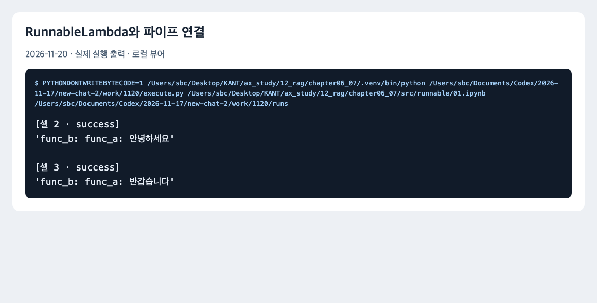

[강의 원문](https://app.notion.com/p/41e1769337a1809f94dcc3db532f0495?pvs=204)

## @chain 데코레이터

- 함수를 Runnable로 감싸 `invoke`, `batch` 등 공통 실행 인터페이스로 호출할 수 있게 한다.
- 조건문·루프 등 절차적 로직을 함수 안에 작성하고 다른 Runnable과 연결할 수 있다.
- 실습에서는 데코레이터를 적용한 `func_a`에 일반 함수 `func_b`를 연결했다.

```python
from langchain_core.runnables import chain

@chain
def func_a(text):
    return f"func_a: {text}"

def func_b(text):
    return f"func_b: {text}"
```

```python
run_ab = func_a | func_b

run_ab.invoke("안녕")
```

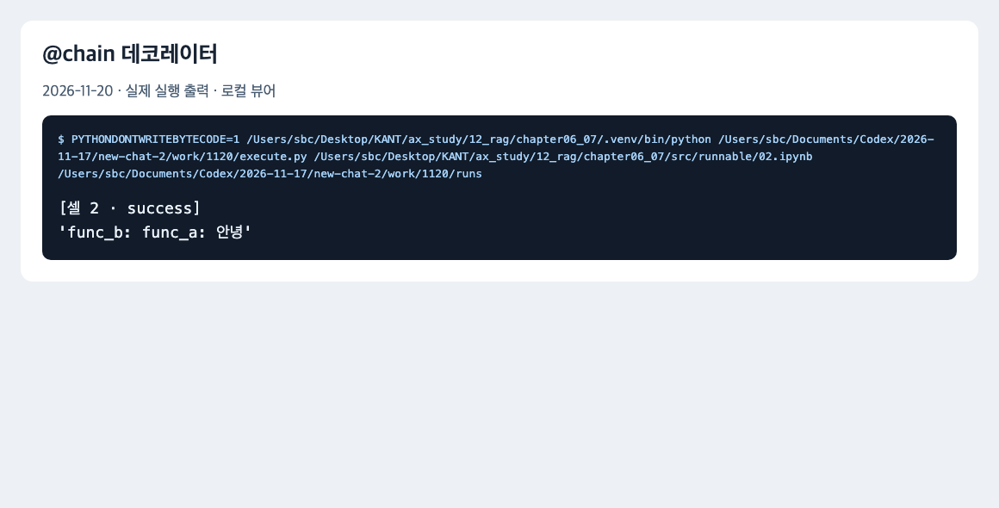

## RunnableParallel

- 동일한 입력을 독립적인 여러 작업으로 전달하고 결과를 딕셔너리로 모은다.
- `run_a`, `run_b` 키에 각 함수의 반환값이 담겼다.

```python
# 병렬 실행 Runnable, RunnableParallel

from langchain_core.runnables import RunnableParallel, RunnableLambda

def func_a(text):
    return f"runc_a {text}"

def func_b(text):
    return f"runc_b {text}"
```

```python
chain = RunnableParallel(
    run_a=RunnableLambda(func_a),
    run_b=RunnableLambda(func_b)
)

result = chain.invoke("안녕하세요")

print(result)
```

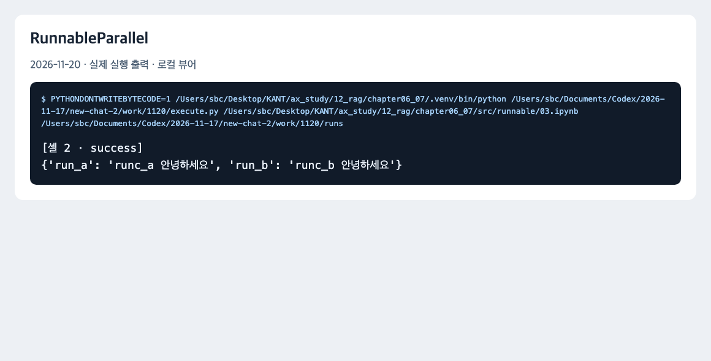

## RunnablePassthrough와 입력 보존

- `RunnablePassthrough()`는 입력을 그대로 다음 단계로 전달한다.
- `RunnablePassthrough.assign()`은 딕셔너리 입력의 기존 필드를 보존하면서 계산한 필드를 추가한다.

### 원본 실행에서 막힌 점
- `runnable/04.ipynb`는 탭·공백이 섞여 `TabError`가 발생했다.
- 함수 인자는 `text`인데 내부에서는 미정의 `data`를 사용한다. 딕셔너리 키 `orignal_text`도 정의되지 않았다.

```python
# RunnablePassthrough(): 입력값을 그대로 전달

from langchain_core.runnables import RunnablePassthrough, chain

def func_a(text):
    data['text'] = f"##{data['text']}##"

	return data

def func_b(text):
    data['text'] = f"##{data['text']}##"

	return data

chain = {orignal_text: RunnablePassthrough() } | func_a | func_b
```

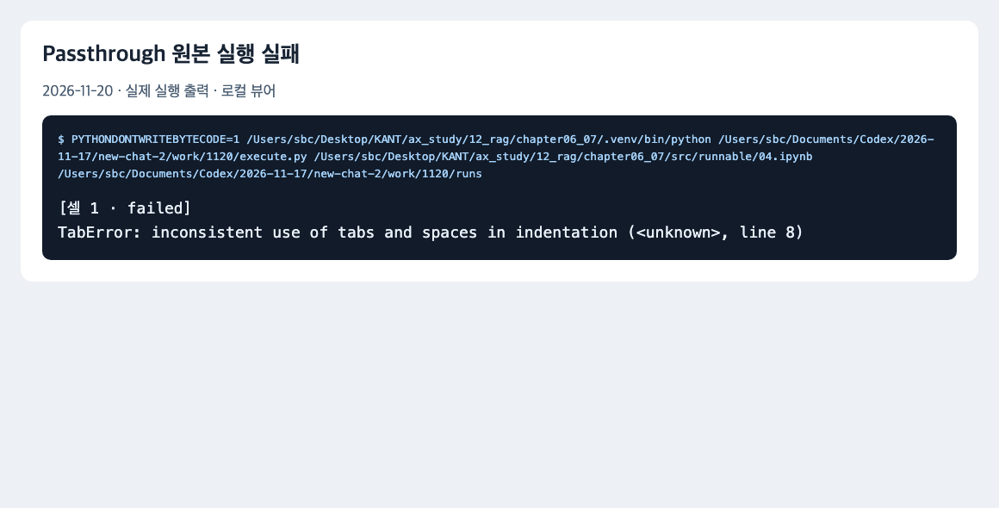

### 별도 실행본으로 확인
- 함수 입력을 `data`로 맞추고 키를 문자열 `"text"`로 명시했다.
- 첫 함수를 `RunnableLambda`로 감싸 딕셔너리와 파이프로 연결했다.
- 각 함수가 `text` 값 양옆에 `##`를 붙여 최종적으로 `####안녕하세요####`가 반환됐다.
- 아래는 이번 TIL을 위해 만든 수정 실행본이다.

```python
from langchain_core.runnables import RunnablePassthrough, RunnableLambda

def func_a(data):
    return {**data, "text": f"##{data['text']}##"}

def func_b(data):
    return {**data, "text": f"##{data['text']}##"}

chain = {"text": RunnablePassthrough()} | RunnableLambda(func_a) | func_b
print(chain.invoke("안녕하세요"))
```

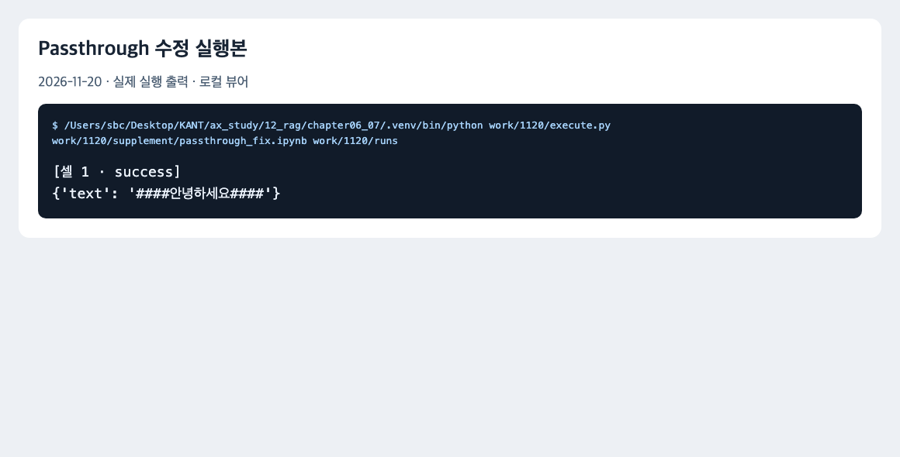

## RunnableBranch와 RunnableEach

### 조건부 분기
- `RunnableBranch`는 조건을 순서대로 평가해 참인 분기를 실행한다.
- 어느 조건도 참이 아니면 마지막 기본 분기를 실행한다.
- `'C'`를 입력해 기본 분기의 `A, B 중에 입력`을 반환했다.

```python
# 조건부 분기 , RunnableBranch(
# 							함수, 함수 결과가 참일때 실행되는 Runnable 객체
#							Fallback Runnable 객체 - 모두 참이 아닌 경우)

from langchain_core.runnables import RunnableBranch, RunnableLambda

branch = RunnableBranch(
    (lambda x: x == 'A', RunnableLambda(lambda x: f"A 입력")),
    (lambda x: x == 'B', RunnableLambda(lambda x: f"B 입력")),
    RunnableLambda(lambda x: f"A, B 중에 입력")
)

branch.invoke('C')
```

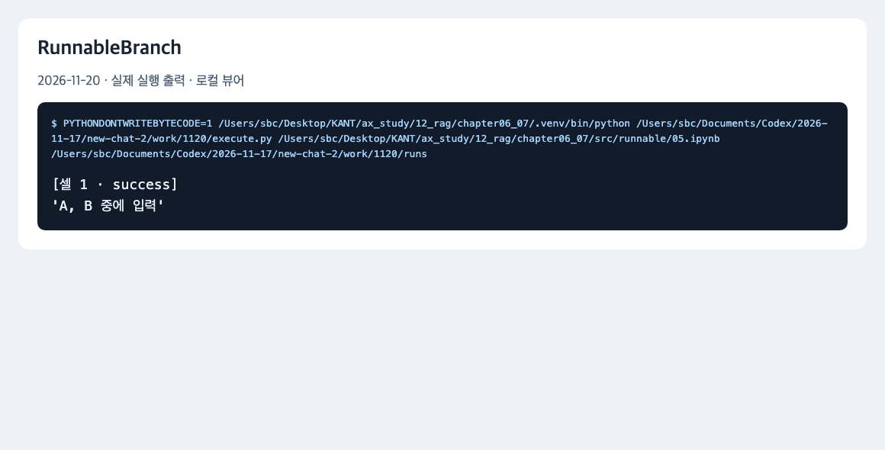

### 목록 순회
- `RunnableEach(bound=...)`는 목록의 각 원소에 같은 Runnable을 적용한다.
- 과일 이름 각각을 `**`로 감싼 목록이 반환됐다.

```python
# 반복 순회 실행 - RunnableEach

from langchain_core.runnables import RunnableLambda
from langchain_core.runnables.base import RunnableEach, RunnableLambda

func_a = RunnableLambda(lambda x: f"**{x}**")

chain = RunnableEach(bound=func_a)

fruites = ['사과', '오렌지', '망고']

chain.invoke(fruites)
```

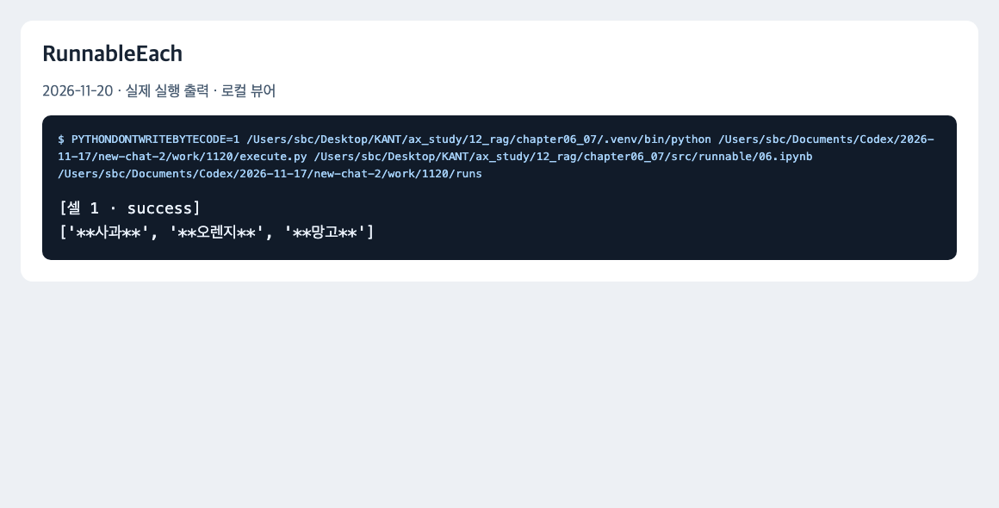

## Fallback과 Retry

- `with_fallbacks()`는 원래 Runnable이 실패했을 때 대체 Runnable을 실행한다.
- `with_retry()`는 지정한 예외가 발생하면 같은 작업을 제한 횟수 내에서 재시도한다.
- 10은 정상 처리됐고, -10은 원래 함수가 예외를 내 대체 처리됐다.
- 재시도 예제는 1·2회차에 의도적으로 `ConnectionError`를 발생시킨 뒤 3회차에 성공했다.

```python
# 대체 처리 - with_fallbacks(..)

from langchain_core.runnables import RunnableLambda, chain

@chain
def func_a(x):
    if x <= 0:
        raise ValueError("0 이하의 값은 처리할 수 없습니다.")
    return f"정상 처리:{x}"

@chain
def fallback_func_a(x):
    return f"대체 처리...{x}"


func_a2 = func_a.with_fallbacks([fallback_func_a])

print(func_a2.invoke(10))
print(func_a2.invoke(-10))
```

```python
# 재시도 - with_retry

from langchain_core.runnables import chain

attempts = 0

@chain
def func_a(text):
  global attempts
	
  attempts += 1
	
  print(f"시도 {attempts}회차 실행중...")
  if attempts < 3:
          raise ConnectionError("네트워크 장애...")
  return f"성공, 처리 완료"

func_a2 = func_a.with_retry(
	stop_after_attempt=3,
	retry_if_exception_type=(ConnectionError,)
)

result = func_a2.invoke("테스트")
print(result)
```

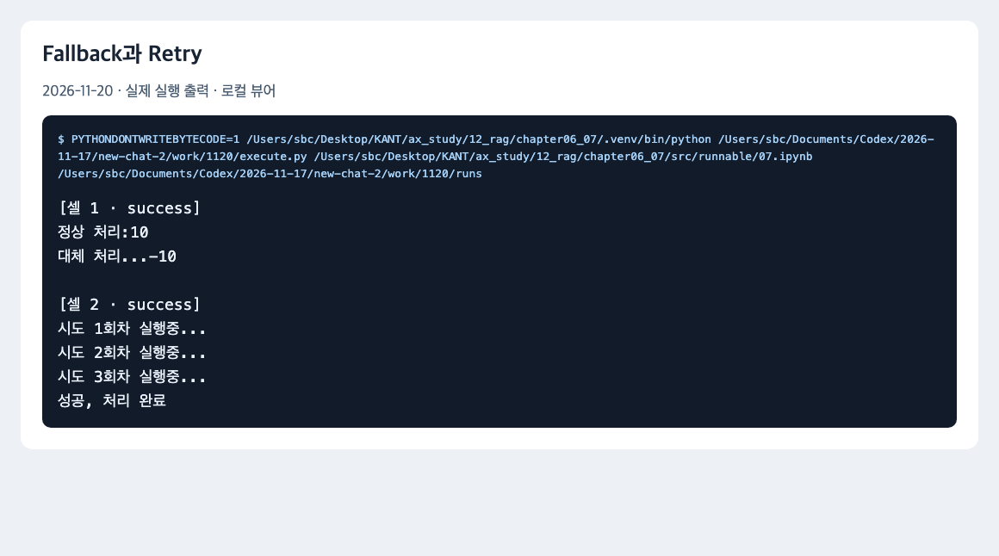

## 5-1 자연어 출력과 구조화 출력 비교

- 자연어 출력은 사람이 읽기 쉽지만 키 이름·문장 구조가 달라질 수 있어 후속 처리가 어렵다.
- JSON 출력은 키와 값을 기준으로 데이터를 추출하고 API·DB·업무 분류에 연결할 수 있다.
- `response_format={"type": "json_object"}`는 JSON 형식 응답을 요청한다. 필수 키와 값의 의미 검증은 별도로 고려한다.
- `StrOutputParser()`로 문자열을 받은 뒤 `json.loads()`로 Python 딕셔너리로 변환한다.
- 실습에서 주문번호 `2026-9876`, 상품명 `무선 키보드`, 스페이스바 불량 내용을 추출했다.

```python
test_inquiry = "어제 주문번호 2026-9876으로 무선 키보드를 주문했는데 스페이스바가 안 눌림" # 주문번호, 주문 상품, 불만사항
```

```python
from langchain.chat_models import init_chat_model
from langchain_core.prompts import ChatPromptTemplate
from langchain_core.output_parsers import StrOutputParser
import json

model = init_chat_model(
    model="gpt-6-luna",
    model_provider="openai",
    reasoning_effort="low"
)

prompt = ChatPromptTemplate.from_messages([
    ("system", """
		반드시 다음 JSON 형식으로 출력하세요. 추가적인 설명이나 문구는 포함하지 마세요.

        {{
            "order_id" : "주문번호", 
            "product_name" : "상품명",
            "issue" : "불만 사항 요약"
        }}
		"""),
        ("user", "{question}")
])

json_model = model.bind(response_format={"type" : "json_object"})

chain = prompt | json_model | StrOutputParser()

result = chain.invoke(test_inquiry)

print(result)

parsed_data = json.loads(result)

print(parsed_data)
```

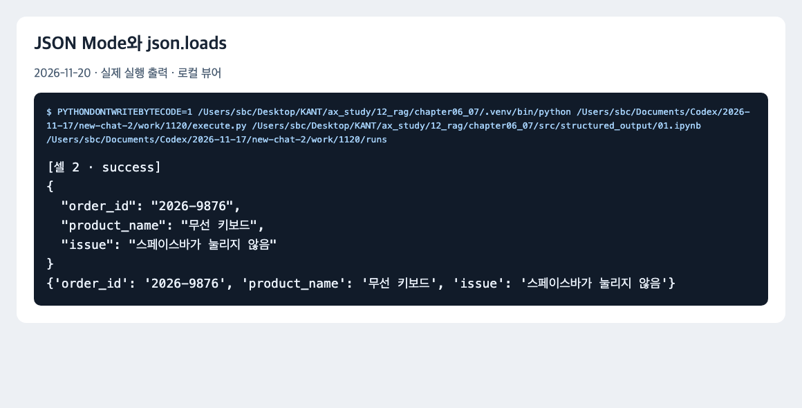

[강의 원문](https://app.notion.com/p/af41769337a1820b91bd011f90335d37?pvs=204)

## 5-2 JSON Schema 설계

### 스키마 구성
| 항목 | 역할 |
| --- | --- |
| `type` | object, array, string, integer 등 타입 |
| `properties` | 객체 필드의 구조와 제약 |
| `description` | 필드 의미와 추출 지침 |
| `required` | 반드시 존재해야 할 키 |
| `enum` | 허용할 값의 선택지 |
| `items` | 배열 원소의 스키마 |

- 키의 필수 여부와 값의 null 허용 여부는 각각 정의한다.
- 매장 정보는 중첩 객체로, 구매 품목은 객체 배열로 모델링한다.
- `with_structured_output(receipt_schema)`에 스키마를 전달해 영수증 텍스트를 구조화한다.
- 스마트스토어 강남점, 무선 마우스 2개·개당 25,000원, C타입 케이블 1개·12,000원, 카드 결제가 추출됐다.

```python
# 중첩 객체와 배열이 포함된 이커머스 영수증 스키마를 정의합니다.
receipt_schema = {
    "title": "ReceiptData",
    "description": "영수증 텍스트에서 결제 정보와 구매 품목 목록을 추출하는 스키마",
    "type": "object",
    "properties": {
        "store_info": {
            # 중첩 객체: 매장 정보
            "type": "object",
            "properties": {
                "store_name": {"type": "string", "description": "상점 이름"},
                "branch": {"type": "string", "description": "지점명"}
            },
            "required": ["store_name"]
        },
        "items": {
            # 배열 구조: 구매 품목 리스트
            "type": "array",
            "description": "구매한 상품 항목들의 목록",
            "items": {
                "type": "object",
                "properties": {
                    "item_name": {"type": "string", "description": "상품명"},
                    "quantity": {"type": "integer", "description": "구매 수량"},
                    "price": {"type": "integer", "description": "개당 가격"}
                },
                "required": ["item_name", "quantity", "price"]
            }
        },
        "payment_type": {
            "type": "string",
            "enum": ["카드", "현금", "간편결제"],
            "description": "결제 수단"
        }
    },
    "required": ["store_info", "items", "payment_type"]
}


receipt_text = """
[스마트스토어 강남점] 영수증
- 무선 마우스 2개 (개당 25,000원)
- C타입 케이블 1개 (개당 12,000원)
신용카드로 일시불 결제 완료되었습니다.
"""
```

```python
from langchain.chat_models import init_chat_model

model = init_chat_model(
    model="gpt-6-luna",
    model_provider="openai",
    reasoning_effort="low"
)

structured_model = model.with_structured_output(receipt_schema)

result = structured_model.invoke(receipt_text)

print(result)
```

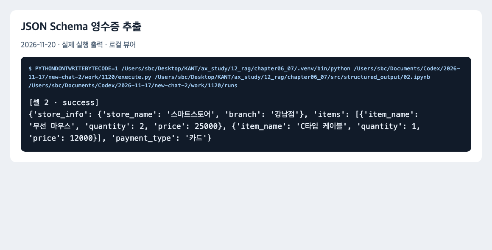

[강의 원문](https://app.notion.com/p/db81769337a18264980681789bdc4cbd?pvs=204)

## 5-3 Pydantic 기반 출력 검증

- `BaseModel`과 타입 힌트로 출력 스키마를 정의한다.
- `Field(description=...)`는 필드 의미를 설명하고, `Literal`은 선택지를 제한한다.
- `Optional[str]`은 None 허용을 나타낸다. 실습의 `branch`는 `default=None`도 지정했다.
- `StoreInfo`, `PurchasedItem`을 중첩해 `ReceiptAnalysis`를 구성한다.
- `with_structured_output(ReceiptAnalysis)` 실행 결과의 타입은 `ReceiptAnalysis`였고, 중첩 데이터도 모델 객체로 반환됐다.

```python
import json
from dotenv import load_dotenv
from langchain_openai import ChatOpenAI
from pydantic import BaseModel, Field
from typing import List, Literal, Optional

# .env 파일에 등록된 API 키를 활성화합니다.
load_dotenv()

# --- [1] 중첩 데이터 모델 정의 ---

# 개별 구매 상품 정보를 담는 하위 모델을 정의합니다.
class PurchasedItem(BaseModel):
    # 상품명을 추출합니다.
    item_name: str = Field(description="상품 이름")
    # 구매 수량을 정수형으로 추출합니다.
    quantity: int = Field(description="구매 수량")
    # 개당 가격을 정수형으로 추출합니다.
    price: int = Field(description="개당 가격(원 단위)")

# 매장 정보를 담는 하위 모델을 정의합니다.
class StoreInfo(BaseModel):
    # 상점 이름을 추출합니다.
    store_name: str = Field(description="상점 이름")
    # 지점명을 추출하여 정보가 없으면 None을 허용합니다.
    branch: Optional[str] = Field(default=None, description="지점명")

# 전체 영수증 데이터를 통합하는 최상위 모델을 정의합니다.
class ReceiptAnalysis(BaseModel):
    # 매장 정보 모델을 중첩 객체로 포함합니다.
    store: StoreInfo = Field(description="매장 정보")
    # 여러 개의 품목을 리스트 형태로 수집합니다.
    items: List[PurchasedItem] = Field(description="구매한 상품 목록")
    # 결제 수단을 3가지 항목으로 엄격히 제한합니다.
    payment_type: Literal["카드", "현금", "간편결제"] = Field(description="결제 수단")

receipt_text = """
[스마트스토어 강남점] 영수증
- 무선 마우스 2개 (개당 25,000원)
- C타입 케이블 1개 (개당 12,000원)
신용카드로 일시불 결제 완료되었습니다.
"""
```

```python
from langchain.chat_models import init_chat_model

model = init_chat_model(
    model="gpt-6-luna",
    model_provider="openai",
    reasoning_effort="low"
)

structured_model = model.with_structured_output(ReceiptAnalysis)

result = structured_model.invoke(receipt_text)

print(type(result))
print(result)
```

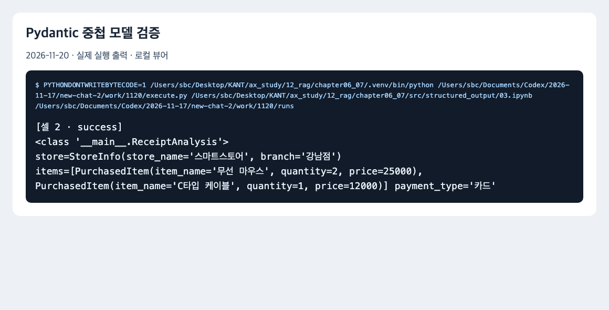

[강의 원문](https://app.notion.com/p/f131769337a183bfbce2811012f99375?pvs=204)

## 5-4 Validation Error와 출력 복구

### 검증과 복구 흐름
- 필수값 누락, 타입 불일치, 선택지 위반, 범위 위반을 스키마로 검사한다.
- 검증 오류가 나면 원본 입력·실패 데이터·오류 메시지를 함께 전달해 다시 생성한다.
- 복구 결과도 같은 스키마로 검증하고 재시도 횟수를 제한한다.

### 보충 실습
- 지정한 폴더에 5-4 전용 노트북이 없어 강의의 카페 주문 예제를 바탕으로 별도 실행본을 작성했다.
- 오류 경로를 확실히 확인하기 위해 `temperature="따뜻하게"`인 데이터를 의도적으로 `model_validate()`에 전달했다.
- `Literal["HOT", "ICE"]` 위반으로 `ValidationError`를 확인한 뒤 모델에 한 차례 복구를 요청했다.
- 실제 복구 결과는 아메리카노·HOT·2잔이었다. 최초 잘못된 데이터는 실습용으로 직접 구성한 값이다.

```python
from typing import Literal
from pydantic import BaseModel, Field, ValidationError
from langchain.chat_models import init_chat_model

class CafeOrderSchema(BaseModel):
    menu_name: str = Field(description="음료 이름")
    temperature: Literal["HOT", "ICE"]
    quantity: int = Field(gt=0)

# 검증 오류 경로를 확인하기 위해 의도적으로 잘못된 데이터를 입력한다.
user_text = "아메리카노 따뜻하게 2잔 준비해 주세요."
invalid_data = {"menu_name": "아메리카노", "temperature": "따뜻하게", "quantity": 2}

model = init_chat_model(
    model="gpt-6-luna", model_provider="openai", reasoning_effort="low"
)
structured_model = model.with_structured_output(CafeOrderSchema)

try:
    final_order = CafeOrderSchema.model_validate(invalid_data)
except ValidationError as error:
    print("1차 검증 실패")
    print(error)
    repair_prompt = (
        f"원본 주문: {user_text}\n"
        f"실패한 데이터: {invalid_data}\n"
        f"검증 오류: {error}\n"
        "원본 주문의 의미를 유지해 스키마에 맞게 복구하세요. "
        "temperature는 HOT 또는 ICE이고, quantity는 양의 정수입니다."
    )
    final_order = structured_model.invoke(repair_prompt)
    print("\n2차 검증 완료")

print(final_order.model_dump_json(indent=2))
```

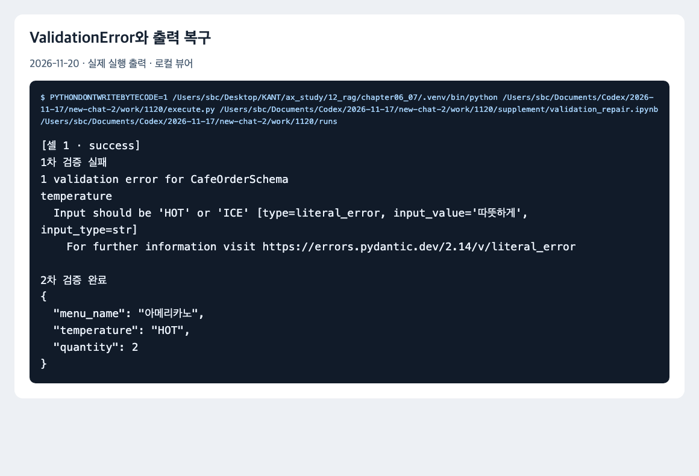

[강의 원문](https://app.notion.com/p/b861769337a182ec9d3781ebcd8fba95?pvs=204)
